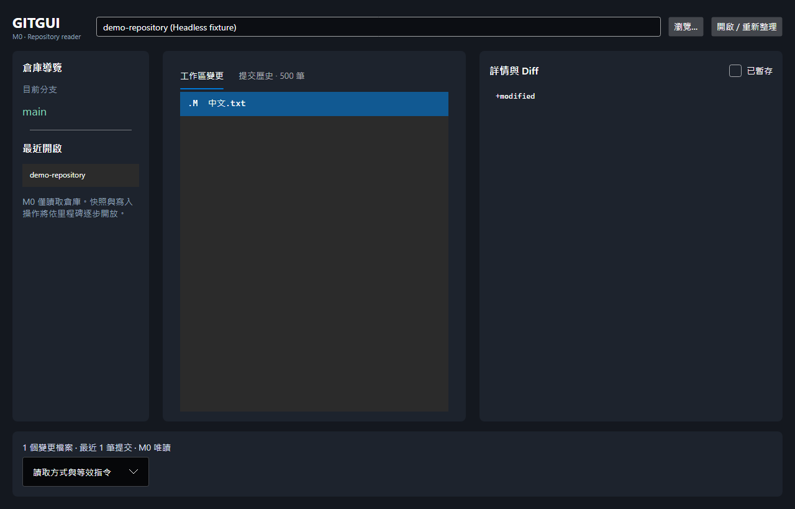

# GITGUI

[](https://github.com/linhercherng/GITGUI/actions/workflows/ci.yml)

跨平台桌面 Git 用戶端，以 **C# / .NET 8 + Avalonia 11** 建立。所有寫入與網路操作預計只走 git CLI；高頻讀取使用 LibGit2Sharp，遇不支援的倉庫格式自動切回 CLI。

**目前狀態：M0 基礎版本，僅提供讀取功能。原始架構規格是產品目標，並非已完成的功能清單。**



上圖由 Avalonia Headless 以固定測試資料渲染；真實倉庫讀取由獨立整合測試驗證。

## 執行

需求：.NET SDK **8.0.404** 或同屬 .NET 8 的較新 SDK、Git **2.40+**。Git 必須在 PATH 中。

```powershell
git clone https://github.com/linhercherng/GITGUI.git
cd GITGUI
dotnet restore GitGui.sln --locked-mode
dotnet run --project src/GitGui.App
```

使用「瀏覽」選取 Git **倉庫根目錄**，或輸入路徑後按「開啟 / 重新整理」。左欄顯示分支與最近倉庫；中欄切換變更與提交歷史；右欄顯示未暫存／已暫存 Diff 與提交中繼資料。重新取得視窗焦點會刷新。

```powershell
dotnet build GitGui.sln -c Release
dotnet test GitGui.sln -c Release
dotnet run --project tests/GitGui.Benchmarks -c Release
```

## M0 已提供

- 七個主專案，Core 不參照 UI、Git 函式庫或 Process。
- 真實倉庫的 status、中文與特殊檔名、未暫存／已暫存 unified Diff。
- 目前 HEAD 最近 500 筆提交；SHA-1/files 使用 LibGit2Sharp，SHA-256/reftable 或函式庫失敗時走 CLI。
- 三欄繁體中文介面、SQLite 最近倉庫、14 日滾動生命週期日誌。
- CLI 使用 ArgumentList、literal pathspec、停用可選鎖與 fsmonitor；Diff 停用 external diff 與 textconv。取消會終止行程樹。
- 核心與解析器單元測試、暫存真實倉庫整合測試、Avalonia.Headless UI 測試、解析器基準測試入口。
- Windows / macOS / Linux 建置與測試工作流程。

## 後續里程碑

完整項目見 [ROADMAP](docs/ROADMAP.md) 與 [原始架構規格](docs/specification.md)。

目前尚未開放 init/clone、stage/unstage、commit/amend、分支操作、fetch/pull/push、merge、快照／復原、檔案監看、提交圖、hunk/行暫存、AvaloniaEdit、衝突編輯器、內建終端機、英文資源與單一實例控制。寫入功能必須與快照／復原安全測試一併完成。

## 資料與限制

- 資料目錄：`.NET LocalApplicationData/GitGui`。Windows 通常是 `%LOCALAPPDATA%\GitGui`；只存最近倉庫路徑與生命週期日誌，不存憑證或檔案內容。
- M0 不實作完整的倉庫信任管理；唯讀指令固定關閉外部 fsmonitor 與 Diff 程式，仍應只開啟你有權使用的本機倉庫。
- CLI 每個輸出串流上限 4 MiB，過大會顯示錯誤；Diff 尚無語法高亮與大檔折疊。未追蹤檔案只列出，不載入內容。
- 狀態解析保留原始路徑位元組；M0 顯示使用 UTF-8，無效 UTF-8 路徑的 Diff 選取與 Big5 commit 解碼仍待實作。
- 尚未宣稱通過 10 萬 commit／5 萬檔案的效能目標。CI 現階段使用 runner 內建 Git；Git 2.40 精確版本矩陣、reftable 整合測試與大型基準門檻仍待補齊。
- .NET 8 的支援期限與升級 .NET 10 是正式發行前的追蹤事項。
- 原規格未決定授權方式，目前未附開源 LICENSE；公開程式碼不代表授予再散佈授權。

## 設計依據

- [Git porcelain v2](https://git-scm.com/docs/git-status#_porcelain_format_version_2)
- [Git Diff](https://git-scm.com/docs/git-diff)
- [LibGit2Sharp 官方專案](https://github.com/libgit2/libgit2sharp)
- [Avalonia 官方文件](https://docs.avaloniaui.net/docs/get-started/)
- [Avalonia Headless 測試](https://docs.avaloniaui.net/docs/testing/setting-up-the-headless-platform)
- [.NET SDK global.json](https://learn.microsoft.com/en-us/dotnet/core/tools/global-json)

原始規格日期：2026-10-23。來源文字中的兩份嵌入式架構／里程碑圖表未包含原圖，保存文字標記供後續補齊。
