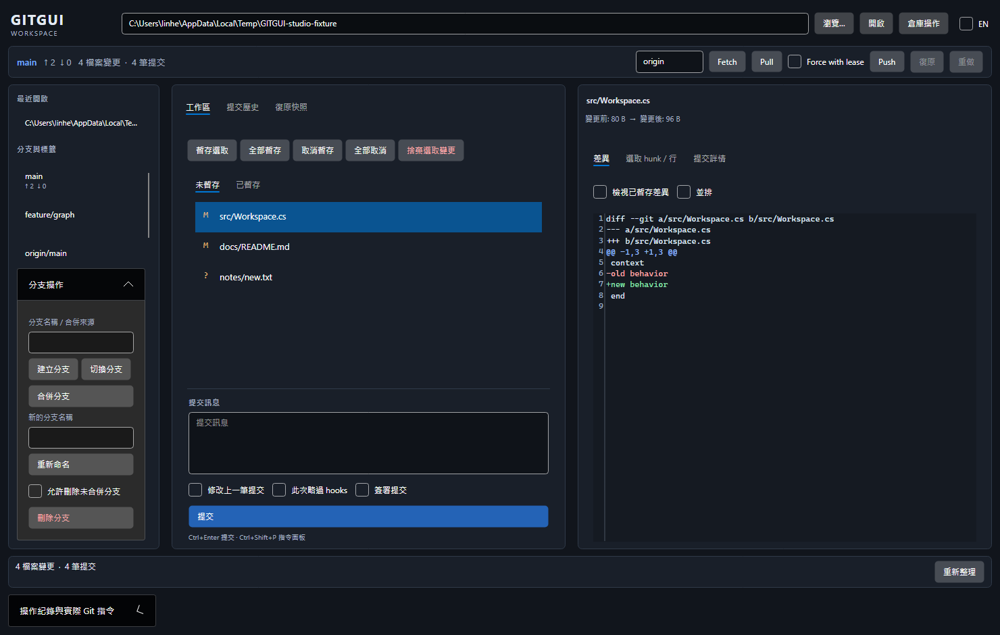
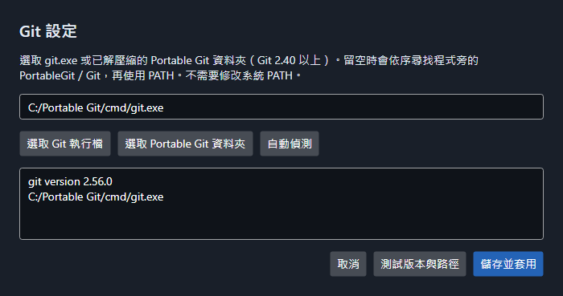
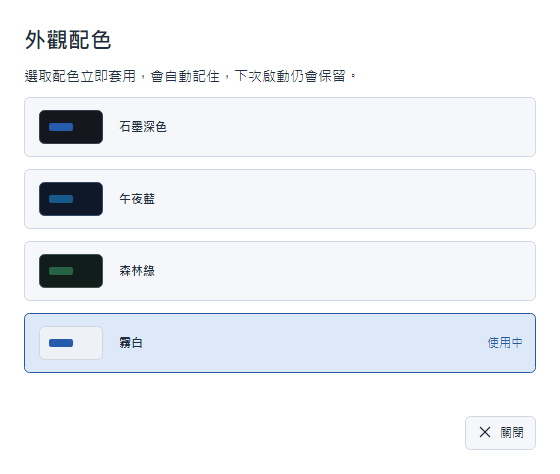

# GITGUI

[](https://github.com/linhercherng/GITGUI/actions/workflows/ci.yml)

跨平台桌面 Git 用戶端，使用 **C# / .NET 8 + Avalonia 11**。**M1 已實作 11 項 P0 日常功能、安全快照與復原**，並提供內附 Portable Git 的 Windows x64 免安裝版。



截圖由真正的 Avalonia 控制項以固定測試資料渲染；Git 操作另以隔離的真實倉庫測試。更多畫面：[提交圖](docs/images/m1-headless-history.png)、[三方衝突編輯](docs/images/m1-headless-conflict.png)。

## Windows 免安裝版

從 [GitHub 最新 Release](https://github.com/linhercherng/GITGUI/releases/latest) 下載 `GITGUI-0.2.0-win-x64-portable.zip`，解壓縮整個資料夾後開啟 **GitGui.App.exe**。內附 **.NET 8.0.32 + 完整 Portable Git 2.56.0.3**，不需另外安裝 .NET、Git 或設定 PATH。適用 Windows 10/11 x64；本版執行檔未簽章。

請保留整個資料夾及 DLL。免安裝指執行環境隨附，設定與快照索引仍存於 `%LOCALAPPDATA%\GitGui`；Git 使用個人的作者、憑證與 SSH 設定。曾手動指定其他 Git 的使用者，可在「Git 設定」選「自動偵測」後儲存，切回隨附版本。封裝流程與驗證見 [Windows 發行說明](docs/WINDOWS-RELEASE.md)。

## 從原始碼執行

需要 .NET SDK **8.0.404** 或同屬 .NET 8 的較新 SDK，以及 Git **2.40+**。支援已安裝的 Git 與 **Portable Git**，不要求 Git 在系統 PATH 中。

```powershell
git clone https://github.com/linhercherng/GITGUI.git
cd GITGUI
dotnet restore GitGui.sln --locked-mode
dotnet run --project src/GitGui.App
```

使用「瀏覽」與「開啟」載入本地倉庫；「倉庫操作」建立或 clone 到新／空目錄。首次寫入需要信任倉庫，對話框會列出可能執行程式的 Git 設定。

## Portable Git

開啟右上角「Git 設定」，選取已解壓縮的 Portable Git 資料夾或其中的 `cmd/git.exe`，按「測試版本與路徑」後「儲存並套用」。設定會保存，下一次啟動繼續使用。

也可將完整 Portable Git 放在程式執行檔旁的 `PortableGit` 或 `Git` 資料夾，再選「自動偵測」。搜尋順序：已儲存路徑 → 程式旁 PortableGit/Git（亦支援 tools 子目錄）→ PATH。請保留整個解壓縮目錄，包含 helpers、SSH 與 shell，不能只複製 git.exe。



下載來源：[Git for Windows 官方發行頁](https://github.com/git-for-windows/git/releases/latest)。完整配置與測試證據見 [Portable Git 說明](docs/PORTABLE-GIT.md)。

## 圖示與外觀配色

v0.2.0 加入應用程式圖示、一致的線條操作圖示與按鈕層級。右上角「外觀配色」可選 **石墨深色、午夜藍、森林綠、霧白**；選取立即套用，重啟後保留。主視窗、Diff／衝突編輯器、提交圖、Git 設定與安全確認對話框同步換色。儲存失敗會提示並保留原配色。



四款實際 Avalonia 畫面：[石墨](docs/images/appearance-graphite.png)、[午夜藍](docs/images/appearance-midnight.png)、[森林綠](docs/images/appearance-forest.png)、[霧白](docs/images/appearance-porcelain.png)。截圖使用固定測試資料，另有行為與原生桌面啟動測試；詳細說明見 [外觀說明](docs/APPEARANCE.md)。

## M1 功能

| 功能 | 使用方式 |
| --- | --- |
| 開啟、init、clone | 路徑列與「倉庫操作」 |
| 狀態 | 未暫存／已暫存清單、多選、分支與上游 ahead/behind |
| 檔案、hunk、行暫存與取消 | 檔案工具列；右側「選取 hunk / 行」勾選後套用 |
| 捨棄變更 | 列出選取檔案，確認後建立快照再執行 |
| commit、amend | 提交訊息、修改上一筆、此次略過 hooks、簽章選項；Ctrl+Enter |
| 提交圖、搜尋與篩選 | 拓撲圖、作者／路徑／日期篩選、每批載入 1,000 筆 |
| 工作區與 commit Diff | AvaloniaEdit 行內／並排、大小變化、圖片前後預覽 |
| 分支 CRUD | 左側分支清單與操作；雙擊切換 |
| fetch、pull | 上方工具列；pull 先快照，遵守 pull.ff；rebase 設定會先詢問此次改用 merge |
| push | 預設一般推送；force 僅使用 lease + includes，保護分支另要求輸入名稱 |
| merge 與衝突 | ours/base/theirs、逐段採用一方／雙方、手動編輯結果、儲存後標記已解決，或外部 mergetool／中止 |

視窗為石墨深色三欄，可調欄寬；提供繁中／英文資源、F5、Ctrl+Shift+P 指令面板。檔案監看以 300ms 合併事件，重新取得焦點時補做刷新。操作紀錄顯示實際指令、輸出、退出碼與耗時，可複製。

## 快照與復原

中高風險操作前自動建立快照；一般 commit 與建立分支也保存。上方「復原／重做」與「復原快照」頁籤可還原；還原前另建快照，因此可以重做。

- 保存 HEAD（含 unborn/detached）、本地分支／tag、branch 設定、index stage 0/1/2/3 與旗標、工作目錄原始位元組、未追蹤檔案及 merge 狀態。
- 原始內容存為 Git blob/tree/commit，以 `refs/gitgui/snapshots/` 保護；SQLite 存索引。已測試 `git gc --prune=now` 後復原。
- 不單靠 `stash create`：它不足以保存未追蹤檔案與衝突 index。還原由 Git 產生完整 index，持有 index/ref 鎖後安裝，避免直接改寫二進位 index。
- 保留最近 50 筆或 14 天，取涵蓋範圍較廣者；只清理本產品的快照 refs。忽略檔不會被一般捨棄操作清除；還原會替換的特定忽略路徑會先納入重做快照。
- 本地快照無法回復遠端推送；force push 仍必須經確認。

## 驗證與架構

```powershell
dotnet build GitGui.sln -c Release
dotnet test GitGui.sln -c Release
# Windows：實際 apphost 憑證管線與桌面啟動
./tests/WindowsSmoke.ps1 -AppPath ./src/GitGui.App/bin/Release/net8.0/GitGui.App.exe -Desktop
```

詳細證據與邊界見 [驗證紀錄](docs/VALIDATION.md)、[M1 驗收表](docs/M1-ACCEPTANCE.md)、[架構決策](docs/ARCHITECTURE.md)。七個主專案維持單向相依：Core 無 UI／Process／libgit2；所有寫入與網路都走 git CLI。一般 SHA-1/files 提交圖走 LibGit2Sharp，格式不支援或原生讀取失敗時自動降級；篩選與 Diff 使用 CLI 以保持 Git patch 語意。

## 目前限制

- 快照寫入會拒絕 submodule、sparse checkout、進行中的 rebase/cherry-pick/revert/bisect 及 merge autostash；已在其他 worktree 使用且需要改動的分支也會阻擋復原。
- 為保證原子 refs 復原，M1 不允許把分支 `topic` 直接改名為 `topic/sub` 或反向操作。
- 非 UTF-8 檔案請使用整檔暫存或 ours/theirs；不提供可能改變編碼的逐行暫存／文字衝突編輯。無效 UTF-8 檔名的寫入會安全拒絕。Commit 訊息支援 Big5 fallback。
- 單檔 Diff 超過 1 MiB／20,000 行先摺疊；圖片預覽每側最多 8 MiB；一般 CLI 輸出上限 32 MiB。快照檔案資料另走有界串流。
- 尚未量測 10 萬 commit／5 萬檔案效能目標；精準增量快取、背景自動 fetch、完整無障礙與跨平台安裝檔留待後續。Diff 目前以變更色彩標記，程式語言高亮仍待補齊。
- 遠端同步測試使用隔離的本地 bare remote；未宣稱實測每種 SSH agent、LFS、代理與外部 mergetool。真實 macOS/Linux 桌面互動也需另外驗收。
- 資料存於 `.NET LocalApplicationData/GitGui`（Windows 通常是 `%LOCALAPPDATA%\GitGui`）。信任設定、最近倉庫與快照索引持久保存；憑證經同使用者 AskPass 管線傳遞，不寫入資料庫／日誌。操作輸出僅留本次視窗記憶體；生命週期日誌保留 14 天。
- .NET 8 升級與授權方式是正式版前追蹤事項。目前未附 LICENSE；公開程式碼不代表授予再散佈授權。

原始規格日期：2026-10-23，全文保存於 [specification.md](docs/specification.md)，未改寫原始內容。其他優先級見 [ROADMAP](docs/ROADMAP.md)。
