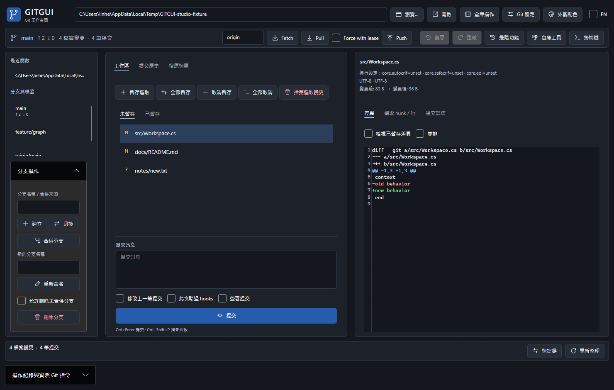
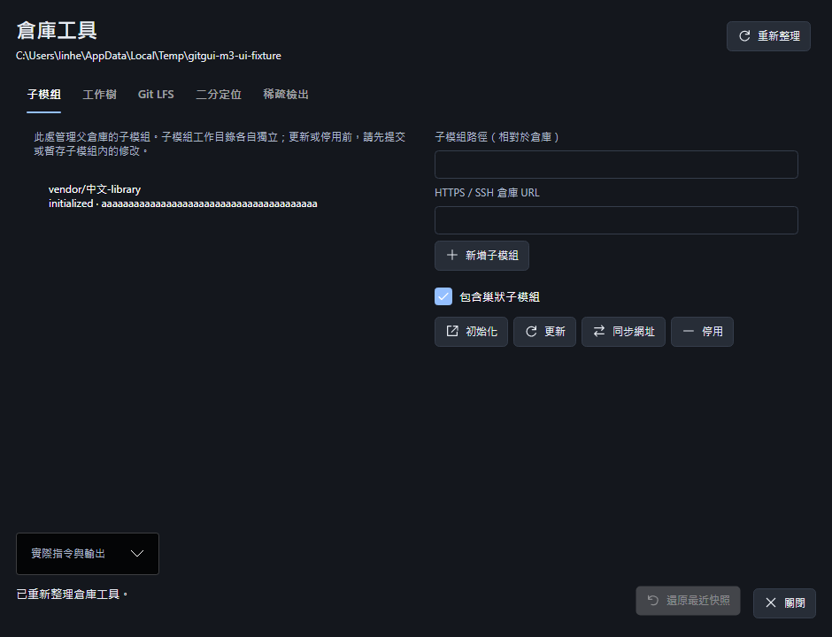
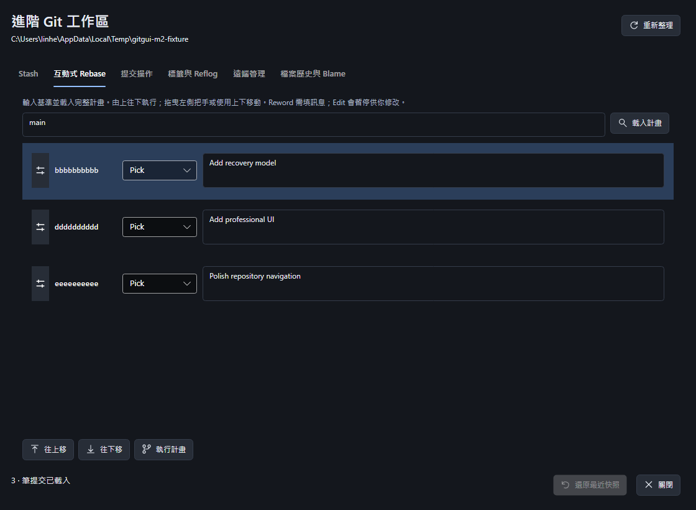

# GITGUI

[](https://github.com/linhercherng/GITGUI/actions/workflows/ci.yml)

跨平台桌面 Git 用戶端，使用 **C# / .NET 10 LTS + Avalonia 11**。提供 **日常 Git 操作、進階歷史、倉庫工具與安全快照復原**，並附完整 Portable Git 的 Windows x64 免安裝版。主程式採 [MIT 授權](LICENSE)。



截圖由真正的 Avalonia 控制項以固定測試資料渲染；Git 操作另以隔離的真實倉庫測試。更多畫面：[提交圖](docs/images/m4-main-history.png)、[三方衝突編輯](docs/images/m3-main-conflict.png)。

## Windows 免安裝版

從 [v0.7.1 Release](https://github.com/linhercherng/GITGUI/releases/tag/v0.7.1) 下載 `GITGUI-0.7.1-win-x64-portable.zip`，解壓縮整個資料夾後開啟 **GITGUI.vbs**。內附 **.NET 10.0.13 + 完整 Portable Git 2.56.0.3**，不需另外安裝 .NET、Git 或設定 PATH。v0.7.1 新增 GUI 初始化已有檔案資料夾與倉庫本機提交者設定，完成 504 項 Windows 本機回歸及解壓啟動檢查。v0.7.0 的 M4 正式效能驗收原門檻保持不變，其受測版本結果為：首次啟動 1,319.86ms、五組捲動均通過、單次產品 UI 工作最大 13.9479ms；詳見 [驗收表](docs/M4-ACCEPTANCE.md)。本版執行檔未簽章，支援OS限制見驗收說明。

預設啟動使用 Windows Script Host；環境不允許 VBS 時，可改用 `GitGui.App.exe`，但備用方式不沿用 1.5 秒啟動驗收結果。

請保留整個資料夾及 DLL。免安裝指執行環境隨附，設定與快照索引仍存於 `%LOCALAPPDATA%\GitGui`；Git 使用個人的作者、憑證與 SSH 設定。曾手動指定其他 Git 的使用者，可在「Git 設定」選「自動偵測」後儲存，切回隨附版本。封裝流程與驗證見 [Windows 發行說明](docs/WINDOWS-RELEASE.md)。

日常操作、進階歷史與 M3 倉庫工具的步驟見 [繁體中文操作手冊](docs/USER-GUIDE.zh-TW.md)。本機可用瀏覽器開啟 `docs/USER-GUIDE.zh-TW.html`；Windows 免安裝包的 HTML／Markdown 手冊與 `GitGui.App.exe` 放在同一層，可離線閱讀。

新手可從第 20、21 章開始，依 16 張真實截圖與編號說明完成首次備份及修改後更新上傳；`images/walkthrough/` 已隨免安裝包提供，圖片可離線點擊放大。

## 從原始碼執行

需要 .NET SDK **10.0.402**（global.json 允許同 feature band 的修補版本），以及 Git **2.40+**。支援已安裝的 Git 與 **Portable Git**，不要求 Git 在系統 PATH 中。

```powershell
git clone https://github.com/linhercherng/GITGUI.git
cd GITGUI
dotnet restore GitGui.sln --locked-mode
dotnet run --project src/GitGui.App
```

使用「瀏覽」與「開啟」載入本地倉庫；「倉庫操作」可初始化已有檔案的資料夾，保留原檔案與 `.gitignore`，並可填寫只用於此倉庫的姓名／Email；clone 仍需要新／空目錄。首次寫入需要信任倉庫，對話框會列出可能執行程式的 Git 設定。

## Portable Git

開啟右上角「Git 設定」，選取已解壓縮的 Portable Git 資料夾或其中的 `cmd/git.exe`，按「測試版本與路徑」後「儲存並套用」。設定會保存，下一次啟動繼續使用。

也可將完整 Portable Git 放在程式執行檔旁的 `PortableGit` 或 `Git` 資料夾，再選「自動偵測」。搜尋順序：已儲存路徑 → 程式旁 PortableGit/Git（亦支援 tools 子目錄）→ PATH。請保留整個解壓縮目錄，包含 helpers、SSH 與 shell，不能只複製 git.exe。


下載來源：[Git for Windows 官方發行頁](https://github.com/git-for-windows/git/releases/latest)。完整配置與測試證據見 [Portable Git 說明](docs/PORTABLE-GIT.md)。

## 圖示與外觀配色

v0.2.0 加入應用程式圖示、一致的線條操作圖示與按鈕層級。右上角「外觀配色」可選 **石墨深色、午夜藍、森林綠、霧白**；選取立即套用，重啟後保留。主視窗、Diff／衝突編輯器、提交圖、Git 設定與安全確認對話框同步換色。儲存失敗會提示並保留原配色。


四款實際 Avalonia 畫面：[石墨](docs/images/appearance-graphite.png)、[午夜藍](docs/images/appearance-midnight.png)、[森林綠](docs/images/appearance-forest.png)、[霧白](docs/images/appearance-porcelain.png)。截圖使用固定測試資料，另有行為與原生桌面啟動測試；詳細說明見 [外觀說明](docs/APPEARANCE.md)。

## M3 倉庫工具

工具列「倉庫工具」提供子模組新增／初始化／更新／同步／停用、工作樹建立／移除／鎖定／清理、Git LFS 本地安裝與追蹤／物件同步、bisect 人工判斷與 reset、cone／noncone sparse-checkout。進階標籤支援使用既有 signer 簽章，簽章提交沿用主畫面選項。



子模組快照限父倉庫，不覆蓋子倉庫資料；sparse 可還原目前工作樹設定、pattern 與檔案。工作樹與 LFS 無快照 Undo；bisect 以原生 reset 結束。詳細步驟與資料保護邊界見 [操作手冊](docs/USER-GUIDE.zh-TW.md)、[M3 驗收表](docs/M3-ACCEPTANCE.md)。

## M2 進階歷史

工具列「進階功能」提供 stash（含未追蹤檔案）、互動式 rebase、cherry-pick／revert、soft／mixed／hard reset、輕量／附註標籤、reflog、遠端管理與檔案歷史／Blame。Rebase 可拖曳排序，指定 pick／reword／edit／squash／fixup／drop；訊息在 UI 編輯，無須呼叫外部編輯器。進行中的操作會在重啟後重新識別，解決衝突後可繼續、略過或中止。



「終端機」提供目前倉庫的持續文字 shell，使用已選定的 Git 與 Portable Git helpers。關閉終端機後才可由 GUI 寫入；任意終端機指令不自動建立快照。此版本採逐行輸入／輸出，不支援 VT 全螢幕、vim/top 或 Ctrl+C 訊號；「關閉終端機」會終止 shell 與其子程序。

互動式 rebase 目前接受線性範圍；含 merge commit 的範圍會在建立快照前拒絕，避免隱含攤平合併歷史。檔案歷史跟隨重新命名，SHA-1/files 優先使用 libgit2，其他格式或讀取失敗改用 Git CLI。驗收範圍見 [M2 驗收表](docs/M2-ACCEPTANCE.md)。

## M1 功能

| 功能 | 使用方式 |
| --- | --- |
| 開啟、init、clone | 路徑列與「倉庫操作」 |
| 狀態 | 未暫存／已暫存清單、多選、分支與上游 ahead/behind |
| 檔案、hunk、行暫存與取消 | 檔案工具列；右側「選取 hunk / 行」勾選後套用 |
| 捨棄變更 | 列出選取檔案，確認後建立快照再執行 |
| commit、amend | 提交訊息、修改上一筆、此次略過 hooks、簽章選項；Ctrl+Enter |
| 提交圖、搜尋與篩選 | 拓撲圖、作者／路徑／日期篩選、首批 500 筆，再分批載入 1,000 筆 |
| 工作區與 commit Diff | AvaloniaEdit 行內／並排、大小變化、圖片前後預覽 |
| 分支 CRUD | 左側分支清單與操作；雙擊切換 |
| fetch、pull | 上方工具列；pull 先快照，遵守 pull.ff；rebase 設定會先詢問此次改用 merge |
| push | 預設一般推送；force 僅使用 lease + includes，保護分支另要求輸入名稱 |
| merge 與衝突 | ours/base/theirs、逐段採用一方／雙方、手動編輯結果、儲存後標記已解決，或外部 mergetool／中止 |

視窗為石墨深色三欄，可調欄寬；提供繁中／英文資源、F5、Ctrl+Shift+P 指令面板。檔案監看以 300ms 合併事件，重新取得焦點時補做刷新。操作紀錄顯示實際指令、輸出、退出碼與耗時，可複製。

## 快照與復原

中高風險操作前自動建立快照；一般 commit 與建立分支也保存。上方「復原／重做」與「復原快照」頁籤可還原；還原前另建快照，因此可以重做。

- 保存 HEAD（含 unborn/detached）、本地分支／tag／遠端追蹤 refs、stash 完整堆疊、branch／remote 設定、index stage 0/1/2/3 與旗標、工作目錄原始位元組、未追蹤檔案及 merge／rebase／cherry-pick／revert 狀態。
- 原始內容存為 Git blob/tree/commit，以 `refs/gitgui/snapshots/` 保護；SQLite 存索引。已測試 `git gc --prune=now` 後復原。
- 不單靠 `stash create`：它不足以保存未追蹤檔案與衝突 index。還原由 Git 產生完整 index，持有 index/ref 鎖後安裝，避免直接改寫二進位 index。
- 保留最近 50 筆或 14 天，取涵蓋範圍較廣者；只清理本產品的快照 refs。忽略檔不會被一般捨棄操作清除；還原會替換的特定忽略路徑會先納入重做快照。
- 本地快照無法回復遠端推送；force push 仍必須經確認。

## 驗證與架構

v0.5.0 的相容性矩陣固定使用 Git **2.40.0** 與查核日最新穩定版 **2.56.0**，各跑 Windows／Ubuntu／macOS Intel 三平台完整套件；實際成功狀態以對應 commit 的六格 CI 為準。SHA-1／SHA-256 搭配 files／reftable 執行相同真實流程，舊版 Git 不支援的 reftable 兩格明確標記 skip。來源、雜湊與重現方式見 [M3 相容性](docs/M3-COMPATIBILITY.md)。Windows ARM64／Linux ARM64 暫不提供正式套件，決策與 native 資產證據見 [ARM 決策](docs/M3-ARM-DECISION.md)。

```powershell
dotnet build GitGui.sln -c Release
dotnet test GitGui.sln -c Release
# Windows：實際 apphost 憑證管線與桌面啟動
./tests/WindowsSmoke.ps1 -AppPath ./src/GitGui.App/bin/Release/net10.0/GitGui.App.exe -Desktop
```

詳細證據與邊界見 [驗證紀錄](docs/VALIDATION.md)、[M1 驗收表](docs/M1-ACCEPTANCE.md)、[架構決策](docs/ARCHITECTURE.md)。七個主專案維持單向相依：Core 無 UI／Process／libgit2；所有寫入與網路都走 git CLI。一般 SHA-1/files 提交圖走 LibGit2Sharp，格式不支援或原生讀取失敗時自動降級；篩選與 Diff 使用 CLI 以保持 Git patch 語意。

## 目前限制

- Submodule 快照僅還原父倉庫，保留子倉庫自己的工作檔、index／refs；sparse 可復原目前工作樹設定與檔案，保留 Git 的 worktreeConfig 儲存升級。進行中的 bisect 請用 bisect reset；已在其他 worktree 使用且需要改動的分支會阻擋快照復原。
- 移除工作樹與更新／停用子模組會拒絕可能隱藏變更的 assume-unchanged／skip-worktree index flags；先保存內容並清除 flags 後再試。
- Hard reset 的目的檔案若被既有目錄擋住，會先拒絕並要求移開目錄，以保護其中的 ignored 資料；其他會被覆寫的 ignored 檔案會納入安全快照。
- 為保證原子 refs 復原，M1 不允許把分支 `topic` 直接改名為 `topic/sub` 或反向操作。
- 非 UTF-8 檔案請使用整檔暫存或 ours/theirs；不提供可能改變編碼的逐行暫存／文字衝突編輯。無效 UTF-8 檔名的寫入會安全拒絕。Commit 訊息支援 Big5 fallback。
- 單檔 Diff 超過 1 MiB／20,000 行先摺疊；圖片預覽每側最多 8 MiB；一般 CLI 輸出上限 32 MiB。快照檔案資料另走有界串流。
- 10 萬 commit／5 萬檔案的效能數據與量測邊界見 [M4 效能](docs/M4-PERFORMANCE.md)。背景自動 fetch 與跨平台安裝檔留待後續。Diff 目前以變更色彩標記，程式語言高亮仍待補齊。
- 遠端同步與 LFS 物件轉移測試使用隔離的本地 bare remote；簽章測試使用臨時 SSH key。未宣稱實測每種 SSH agent、遠端 LFS 服務、代理與外部 mergetool。真實 macOS/Linux 桌面互動也需另外驗收。
- 資料存於 `.NET LocalApplicationData/GitGui`（Windows 通常是 `%LOCALAPPDATA%\GitGui`）。信任設定、最近倉庫與快照索引持久保存；憑證經同使用者 AskPass 管線傳遞，不寫入資料庫／日誌。操作輸出僅留本次視窗記憶體；生命週期日誌保留 14 天。
- M4 使用 .NET 10 LTS，隨包附 .NET 10.0.13。Microsoft 目前支援的桌面平台為 Windows 11、指定 Windows 10 Enterprise/LTSC 版本、macOS 15+、Ubuntu 22.04+；原規格 macOS 13 已離開上游支援週期，不能宣稱完成其實機驗證。來源與相容性範圍見 [M4 驗收](docs/M4-ACCEPTANCE.md)。

原始規格日期：2026-10-23，全文保存於 [specification.md](docs/specification.md)，未改寫原始內容。其他優先級見 [ROADMAP](docs/ROADMAP.md)。

