# GITGUI 操作手冊

適用版本：0.7.1（本機測試版，尚未發布）。Windows x64 免安裝包內含 Portable Git、Git LFS、SSH 工具及 .NET 執行環境。已發布的 0.7.0 通過 M4 正式效能驗收，完整結果見 [效能報告](M4-PERFORMANCE.md)，該版下載與校驗檔見 [v0.7.0 Release](https://github.com/linhercherng/GITGUI/releases/tag/v0.7.0)。

本機修改版新增「已有檔案資料夾初始化」與初始化時的本機提交者設定，尚未更新 GitHub／Release。下列第 20.2 節說明此流程；v0.7.0 的舊截圖未顯示新增的姓名、電子郵件與瀏覽按鈕。既有正式效能數據仍僅對應報告中記錄的受測版本。

第一次將專案備份到 GitHub，請從第 20 章的完整範例開始；之後修改專案並再次上傳，請看第 21 章。

第 20、21 章保留 16 張實際操作截圖與點擊標示。視窗大小或配色不同時，請依同名按鈕操作；GitHub 位置參考圖沿用現有 GITGUI 倉庫。

## 1. 解壓縮與啟動

1. 從本專案 v0.7.0 Release 下載 `GITGUI-0.7.0-win-x64-portable.zip`。
2. 在檔案總管選擇「全部解壓縮」，保留整個資料夾結構。
3. 開啟解壓縮資料夾，執行 **`GITGUI.vbs`**。請勿直接從 ZIP 內執行。
4. 第一次使用可先到「Git 設定」確認執行檔來源為同資料夾下的 `PortableGit\cmd\git.exe`。

不必另外安裝 Git 或 .NET。移動程式時，請搬移整個資料夾。簽章、HTTPS 登入、SSH 遠端連線仍使用你自己的身分設定與金鑰。

預設啟動方式需要 Windows 內建的 Windows Script Host。若你的環境不允許執行 VBS，可改用 `GitGui.App.exe`；本次 1.5 秒冷啟動驗收使用 `GITGUI.vbs`，備用方式的啟動時間可能不同。請保留 `GitGui.Host.dll`、`GitGui.App.r2r.dll`、`PortableGit` 與其他隨附檔案。

若 Windows 顯示下載程式的信任提示，先確認下載自本專案 Release，並核對 `SHA256SUMS.txt`；此版本未提供程式碼簽章。

```powershell
Get-FileHash -LiteralPath 'C:\下載\GITGUI-0.7.0-win-x64-portable.zip' -Algorithm SHA256
```

上方 `C:\下載` 是範例，請換成實際下載位置。

## 2. 畫面與外觀

主畫面左側選擇最近倉庫與 refs，中間切換工作區、提交圖與快照並輸入提交訊息，右側檢視差異、衝突與提交詳情。操作面板可查看實際 Git 指令與輸出。

「外觀」可選擇 Graphite、Midnight、Forest、Porcelain 四種配色。主工具列的 EN 選項可切換繁體中文或英文，會同步更新主視窗、進階、倉庫工具與設定視窗的介面資源。外觀、語系與自訂快捷鍵會保留供下次啟動使用。Git 原始輸出、使用者輸入的分支名稱與提交訊息維持原文。


## 3. 開啟、建立或複製倉庫

- 已有本機倉庫：按「瀏覽」選擇工作目錄，或直接輸入路徑後按「開啟」。
- 建立新倉庫：按「倉庫操作」，瀏覽或填寫專案資料夾，再按「初始化倉庫」；預設初始分支為 `main`。本機修改版也接受已有檔案的資料夾，並保留原檔案，詳見第 20.2 節。
- 從遠端複製：在「倉庫操作」選擇「Clone」，輸入 HTTPS、SSH 或本機倉庫來源，以及全新或空白的目的資料夾。

首次寫入陌生倉庫前，程式會詢問是否信任，並列出可能執行外部程式的 hooks、filters、SSH 或憑證設定。確認來源後再同意。程式不會自動修改 `safe.directory`。

Git 作者資料由 Git 設定提供；若尚未設定，可在內建終端機輸入：

```text
git config --local user.name "你的名字"
git config --local user.email "you@example.com"
```

## 4. 修改、暫存與提交

1. 在編輯器修改工作目錄內的檔案。
2. 回到 GITGUI，按重新整理，或讓視窗重新取得焦點。
3. 選擇變更檔案，檢視差異；按「暫存」將選取檔案加入 index。
4. 文字差異可選擇 hunk 或行來暫存／取消暫存；二進位檔以整檔處理。
5. 輸入提交訊息，按「提交」。只有已暫存的內容進入提交。

「修改上一筆」會重寫最新提交。使用前先確認這筆提交是否已分享給其他人。「略過 hooks」只對本次操作生效；預設不勾選。

「捨棄變更」會替換選取的工作檔案，執行前有確認與快照。請先看清楚檔案清單。

## 5. 分支、同步與衝突

- 建立分支：輸入分支名稱後建立，再切換到該分支。
- 切換分支：選取本機分支、遠端追蹤分支或提交；切換提交會進入 detached HEAD。
- Fetch：取得遠端最新 refs，不合併工作目錄。
- Pull：取得遠端內容後合併，遵守 `pull.ff`；若倉庫設定 rebase，程式會先確認本次改用 merge。
- Push：將目前分支推送到選定遠端。強制推送使用 `--force-with-lease --force-if-includes`；受保護分支需要輸入分支名稱確認。

遇到衝突，選擇衝突檔案，使用三方編輯、整檔 ours／theirs 或外部 mergetool。檢查結果後「標記已解決」，再完成提交或到「進階」繼續操作。二進位與符號連結衝突使用整檔選擇。

## 6. 快照復原與重做

會修改歷史或替換內容的操作，依功能自動建立快照。主畫面快照清單、操作後的「復原」，或工具視窗的「還原最近快照」可還原本地狀態。

1. 先讀取快照的時間與操作名稱。
2. 按還原並確認。程式會先保存目前狀態作為重做快照。
3. 還原後重新整理，確認 HEAD、分支、暫存區與工作檔案。
4. 如需重做，選擇剛才還原前自動建立的快照再還原。

快照保存在倉庫的 Git 物件與內部 refs，清單索引保存在應用程式 SQLite。它是操作復原工具，請另做獨立備份；刪除整個倉庫也會失去這些快照。遠端已推送內容不會因本地還原而撤回。

復原會重建index快取。若曾改動LFS追蹤規則或`.gitattributes`，Git重新計算後的變更標記可能與先前快取不同；請檢視工作檔與暫存內容後再決定下一步。

子模組快照僅處理父倉庫，詳細邊界見第 9 節；工作樹、LFS 與 bisect 依各自方式處理。快照還原若遇到 index/ref 鎖或可能覆蓋未保存資料，會拒絕執行，請先處理原始原因。

更新／停用子模組或移除工作樹時，若 index 有 assume-unchanged 或 skip-worktree flags，程式會保守拒絕，因為 Git status 可能隱藏未保存的內容。先另行備份並清除相關 flags，再重試。
對使用 sparse-checkout 的工作樹，可先在該工作樹停用稀疏檢出，再確認內容並移除。

## 7. 進階歷史操作

按「進階」開啟分頁：

- **Stash**：可包含未追蹤檔案，支援 push、apply、pop、drop。pop 成功後移除該項；發生衝突時請先處理衝突。
- **互動 Rebase**：指定上游，讀取計畫後拖曳／上下移動排序，選擇 pick、reword、edit、squash、fixup、drop；檢查訊息後執行。目前限線性提交，不接受 merge commit 計畫。
- **歷史操作**：選擇提交進行 cherry-pick、revert 或 reset。soft 保留暫存區與工作檔；mixed 重設暫存區；hard 會替換工作檔並要求確認。
- **標籤**：建立輕量、附註或簽章標籤，或刪除本地標籤。這不會自動推送或刪除遠端標籤。
- **檔案歷史／Blame**：選擇檔案查看逐行提交資訊與重新命名前的歷史。刪除的檔案仍可查看歷史。
- **Reflog／遠端**：檢視本地 HEAD 移動紀錄；新增、改名、修改 URL 或移除遠端。移除遠端不會刪除遠端伺服器上的倉庫。

Rebase、cherry-pick 或 revert 中斷時，可使用「繼續」「略過」「中止」。edit 暫停時先修改檔案、暫存並 amend，再繼續。

包含reword的計畫會重播提交，以相容Git2.40的空提交處理；即使前方項目選pick，其OID也可能改變。執行前請檢查計畫，並確認這些歷史是否已分享給他人。

## 8. 內建終端機

「終端機」會使用目前倉庫與同一套選定 Git。它是持續運行的逐行 shell，可輸入 Git 指令與一般命令，也會保留目前 shell 的工作目錄／環境變化。

終端機開啟時會占用該倉庫的寫入佇列；先關閉終端機，再使用圖形介面寫入。關閉會終止 shell 及其子行程。此版本尚未提供完整 VT／PTY、全螢幕互動工具或 Ctrl+C 控制；需要這些功能時請用外部終端機。

終端機內自行輸入的指令不會自動建立 GUI 快照。輸入會刪除或改寫資料的指令前，請自行確認與備份。

## 9. 子模組（Submodules）

按「倉庫工具」→「子模組」。

1. 新增：填入父倉庫內的相對路徑及來源 URL／本機絕對路徑，按「新增子模組」。
2. 已有項目：從清單選擇，按「初始化」登記設定，再按「更新」取出父倉庫 index 所指定的提交。
3. `.gitmodules` URL 變更後，可用「同步網址」同步設定。
4. 「包含巢狀子模組」控制更新／同步的 recursive 行為；不使用 force 或 remote-tracking 更新。
5. 「停用」對應 deinit，會移除子模組工作目錄並清除父倉庫中的初始化設定；髒檔案、未追蹤或被忽略資料會阻擋移除。

**父倉庫快照保存 gitlink、父倉庫 index／檔案與 submodule 設定，不保存子倉庫自己的 HEAD、refs、index、工作檔或物件資料庫。** 更新子模組前，請先在子倉庫內提交或 stash；若要復原子倉庫，請另外開啟該子倉庫操作。

復原「新增子模組」會還原父倉庫，但保留已 clone 的子倉庫資料夾。復原 deinit 不會自動重建子倉庫 checkout，可再初始化／更新。父倉庫一般操作不會自動遞迴切換子模組。檔案與 gitlink 的危險型態替換會被拒絕。

若既有子倉庫內還有巢狀 gitlink，而欲更新的提交尚未下載，程式會要求先在該子倉庫 Fetch，才能檢查目標是否覆蓋巢狀資料。請另行開啟子倉庫取得目標提交後再重試；不會直接以「下載並 checkout」繞過檢查。


## 10. 工作樹（Worktrees）

在「倉庫工具」→「工作樹」，可讓同一倉庫的不同分支同時存在於不同資料夾。

1. 新增：填寫全新或空白的絕對路徑、來源提交，以及新分支名稱。分支名稱留空會建立 detached 工作樹。
2. 選取項目，輸入原因後可鎖定，適合放在外接磁碟上的工作樹；需要移除前先解鎖。
3. 移除會要求確認，保留分支，且拒絕未提交／未追蹤／被忽略資料，不提供 force。
4. 「清理過期紀錄」對應 prune，只清理 Git 判定已失效且未鎖定的紀錄。

工作樹操作沒有快照 Undo。不能從目前正在開啟的工作樹移除自己；先改開另一個工作樹。共用同一個 Git common directory 的 GUI 操作會序列化。

Windows 使用 reftable 格式時，Git 在部分 Windows 版本可能已移除工作樹資料夾，卻因檔案仍被 Git 映射而無法刪除管理紀錄。程式會明確顯示此狀態，不會自動清理。請先確認外接磁碟與其他工作樹仍可存取，再按「清理過期紀錄」並確認；這會清理所有已失效且未鎖定的紀錄，不只剛移除的項目。原分支會保留。

## 11. Git LFS

在「倉庫工具」→「Git LFS」查看版本與狀態。

1. 先按「安裝至此倉庫」，設定本地 filter 與 pre-push hook。
2. 每行輸入一個追蹤規則，例如 `*.psd` 或 `assets/*.bin`，按「追蹤」。
3. 檢查並提交 `.gitattributes` 與實際大型檔案。
4. 設定遠端後，可執行 LFS Fetch 下載物件，或 LFS Pull 下載並取出目前提交的物件。
5. 「取消追蹤」只修改屬性規則，不改寫既有提交中的 LFS pointer 或歷史。

LFS 不是備份，也不自動進行歷史遷移。此工具沒有 LFS 快照 Undo；一般提交／快照仍依原有本地資料處理。遠端必須支援 LFS，登入、額度及網路錯誤會顯示在操作輸出。自訂 `core.hooksPath` 的倉庫，LFS 會依 Git 設定使用該 hooks 位置；既有不相容 hook 可能使安裝失敗。

## 12. 二分定位（Bisect）

在「倉庫工具」→「二分定位」：

1. 先提交或 stash 目前變更。
2. 輸入已知有問題的 bad 提交，以及較早且正常的 good 提交。good 必須是 bad 的祖先。
3. 按「開始」，Git 會取出待測提交。
4. 自行建置／執行程式判斷後，按「正常」「有問題」或「略過」。重複直到找到第一個有問題的提交。
5. 按「重設」執行 `git bisect reset`，回到原先分支／提交。關閉再開程式也能接續目前的 bisect。

此功能不自動執行測試命令，復原方式為 bisect reset。可能被 checkout 覆蓋的未追蹤／被忽略檔案會先被擋下；請先移走或妥善保存，再開始。

## 13. 稀疏檢出（Sparse-checkout）

在「倉庫工具」→「稀疏檢出」：

1. 先保存目前變更。
2. 勾選 cone 模式時，每行填入一個相對目錄，例如 `src`、`docs`；Git 也會保留必要的根層／父層檔案。
3. 不勾選 cone 時，每行使用 Git sparse-checkout 的 pattern 語法。
4. 按「套用」後，未包含的已追蹤檔案會從工作目錄隱藏，仍保存在 Git 歷史內。
5. 按「停用」取回完整工作目錄，或還原操作前快照。

快照還原保存選定工作樹的 sparse 設定、pattern、index skip flags 與實際存在的檔案。Git 啟用的 `extensions.worktreeConfig` 儲存格式升級會保留，以免破壞其他工作樹。資料夾／忽略檔案衝突會先拒絕處理。

## 14. 簽章提交與標籤

先依自己的環境設定 GPG 或 SSH 簽章；程式不產生、不儲存你的私鑰。提交時勾選「簽章」，建立標籤時勾選簽章選項並填寫訊息，即交給 Git 執行 `commit -S` 或 `tag -s`。

SSH 設定範例（請換成已有的私鑰實際路徑）：

```text
git config --local gpg.format ssh
git config --local user.signingkey "C:/Users/你的帳號/.ssh/id_ed25519"
```

簽章需要可用的 signer／agent；硬體金鑰、密碼提示與第三方 GPG 設定依你的環境而定。簽章成功不等同遠端平台已將該金鑰認定為你的帳號，請另外完成平台金鑰登記。

## 15. 快捷鍵、命令選單與無障礙操作

主畫面右下方按「快捷鍵」，可依主視窗、進階與倉庫工具的作用範圍搜尋命令並設定按鍵。

1. 找到命令，在右側欄位輸入組合，例如 `Ctrl+Shift+K`，按該列「儲存」。
2. 清空組合後儲存，即解除該命令的快捷鍵；按鈕與命令選單仍可使用。
3. 按「還原預設」會重設所有自訂快捷鍵。
4. 同一作用範圍不能重複使用相同組合。文字輸入、複製貼上、復原，以及 Tab／方向鍵等保留按鍵不能覆寫；儲存失敗時會顯示原因。

常用預設值：

| 按鍵 | 功能 |
| --- | --- |
| `F5` | 重新整理目前視窗。 |
| `Ctrl+Enter` | 在主視窗提交已暫存內容，仍會檢查訊息、衝突與操作狀態。 |
| `Ctrl+Shift+P` | 開啟目前主視窗／進階／倉庫工具的命令選單，輸入名稱搜尋，再按 Enter 執行。 |
| `F6`／`Shift+F6` | 在主畫面的主要區域間向前／向後切換焦點。 |
| `Tab`／`Shift+Tab` | 在可操作控制項間移動。 |
| `Esc` | 關閉可關閉的對話框或命令選單。 |

尚未綁定按鍵的命令也能從命令選單找到。正在執行操作、沒有選取項目或有未解決衝突時，快捷鍵與按鈕使用相同的停用規則。

介面提供控制項名稱、焦點導覽與提交圖的 automation peer，供輔助工具識別目前提交、清單與按鈕。這些支援包含程式層的無障礙與鍵盤測試；各作業系統原生螢幕閱讀器的實際朗讀與操作結果，仍需另外驗證，尚未宣稱 Windows Narrator 人工驗收通過。

## 16. 中文訊息、路徑與換行設定

右側詳情會顯示選取提交的訊息編碼，以及目前倉庫的 `core.autocrlf`、`core.safecrlf`、`core.eol` 設定與換行轉換提醒。

- 有 `encoding` 標頭的 commit，依標頭解碼；沒有標頭時先讀 UTF-8，若位元組不合法，再嘗試 Big5，並標示偵測結果。
- 未知或無法解碼的訊息會標示狀態。互動 rebase 若需要讀取這類訊息，會要求先用能保留原始位元組的 Git 工具處理，避免把錯誤解碼結果寫回歷史。
- 新提交、amend，以及 rebase 的 reword／自訂 squash 訊息，使用倉庫明確設定的 `i18n.commitEncoding`；未設定時使用 UTF-8。程式保留原設定。
- 若編碼不受支援，或訊息含該編碼無法表示的字元，例如 Big5 設定下的 emoji，會在建立快照或寫入 Git 前拒絕。請修改訊息，或自行確認後變更倉庫的編碼設定，再重試。rebase 暫停期間若改變此設定，須恢復原值才能沿用已保存的訊息檔繼續。

例如要讓之後的新訊息使用 UTF-8，可在確認團隊需求後執行：

```text
git config --local i18n.commitEncoding UTF-8
```

這只調整之後的訊息編碼，不會轉換或修復既有 commit。附註標籤訊息使用 UTF-8。

中文、空格、換行與 emoji 檔名以原始路徑處理。無法以 UTF-8 表示的檔名會用 `\xFF` 等轉義顯示，並保留原始位元組與 rename 來源；為避免誤改同名的有效路徑，相關編輯／暫存操作會被停用或拒絕。請使用支援原始位元組路徑的工具重新命名後再操作。倉庫有此類路徑時，部分暫存也會保守拒絕；其他受支援檔案仍可整檔暫存。非 UTF-8 的文字差異與二進位／符號連結衝突，使用整檔處理，不經文字編輯器另存轉碼。

`core.autocrlf` 未設定時顯示 `unset`，Git 預設視為 `false`。`true`、`input`、`false` 的行尾轉換行為不同，也可能受 `.gitattributes` 影響。請先查看提醒與差異，再決定是否修改設定；GITGUI 不會自動改成另一種換行政策。Windows 的 Git 執行程序會啟用 `core.longpaths`。

## 17. 狀態刷新與提交分頁

外部編輯檔案、切回視窗或按重新整理時，程式可局部更新工作區狀態與目前差異，避免每次都重建整份提交清單。使用者仍可透過重新整理取得新的 refs 與提交內容。

提交圖預設先載入 500 筆。按「載入更多」繼續取得下一頁；搜尋或改變篩選條件會從新的查詢開始。若讀取期間歷史已改變，會重新載入，以免把不同版本的分頁混在一起。

先在搜尋欄輸入文字，按「套用篩選」查詢。作者、路徑、起日與迄日收在「進階篩選」：按標題展開後輸入，再按相同的套用按鈕。收合或切換頁籤會保留已輸入的條件，收合不等於清除；如要取消條件，請展開並清空對應欄位後重新套用。鍵盤可將焦點移到「進階篩選」，按空白鍵展開，再按 Tab 進入欄位。欄位在第一次展開時才建立，讓一般提交圖畫面更快顯示。

提交圖資料備妥後會先顯示，工作區狀態與安全檢查可繼續在背景完成。這段期間仍不能執行寫入操作；若載入失敗，請重新開啟倉庫。歷史未改變時，重新整理會保留已載入的分頁與選取項目。

刷新同一個檔案的差異時，現有文件會保留供閱讀，直到新結果備妥；查詢期間部分暫存仍停用。內容相同時會保留捲動位置與已勾選的差異行。一般 UTF-8／CRLF 文字及圖片預覽使用原生讀取；特殊 filter、編碼或不支援的倉庫格式會使用你選定的 Git，維持原有語意。

大型差異先顯示檔案資訊與提示，需要時再按「仍要載入」。切換檔案後，以目前選取項目的載入結果為準；差異載入中不能送出尚未確認的部分暫存。

v0.7.0 已在十萬筆提交／五萬個檔案的固定測試環境通過原始效能門檻：首次啟動 1,319.86ms、首屏最大 812.25ms、status 最大 236.34ms、Diff 最大 131.24ms、常駐記憶體最大約 221.23MB；五組持續捲動均通過空檔檢查，量測範圍內單次 UI 工作最大 13.9479ms。完整條件、逐筆紀錄與驗證邊界見 [效能報告](M4-PERFORMANCE.md)。

## 18. 錯誤建議與本機日誌

操作失敗時，主視窗、進階與倉庫工具會顯示白話原因及建議動作。例如 lease 過期先 Fetch、非快轉推送先檢查同步狀態、衝突轉到解決流程、登入失敗開啟憑證說明、鎖定問題開啟鎖定說明。請先讀取原始原因，再執行建議；建議按鈕不會略過信任、確認或目前操作狀態的檢查。

提交被辨識為 hook 拒絕時，可按「略過 hooks 重試」；必須另行確認，只重試同一份尚未改變的提交訊息、倉庫與選項，不會把略過設定保存為預設。修改草稿或切換倉庫後，請重新送出提交。其他 hook 操作仍先顯示輸出。

展開「操作面板」可查看實際指令與 Git 輸出，並複製內容。憑證欄位會遮罩；若要將輸出貼給他人，仍請自行檢查倉庫路徑及檔案內容是否適合分享。

0.7.0候選版會在第一次展開時建立輸出區；收合時仍保留指令紀錄，重新展開會顯示最新內容。顯示紀錄設有長度上限，超過上限保留最新部分。單欄Diff切換為左右比對時才建立左右編輯器，後續切換會保留已建立的編輯器。

Windows 的應用程式資料位置：

```text
%LOCALAPPDATA%\GitGui\ui.json          語系與自訂快捷鍵
%LOCALAPPDATA%\GitGui\appearance.json  外觀
%LOCALAPPDATA%\GitGui\gitgui.db        最近倉庫、信任與快照清單等索引
%LOCALAPPDATA%\GitGui\gitgui-YYYYMMDD.log  本機診斷日誌
```

可把 `%LOCALAPPDATA%\GitGui` 貼到檔案總管網址列開啟。macOS／Linux 使用作業系統提供的本機應用程式資料目錄下的 `GitGui` 資料夾。

日誌按日切檔並保留 14 天，也會記錄取消或啟動失敗的指令嘗試。持久化內容包含遮罩後的參數、工作目錄、耗時、結束碼與 stderr 分類，不保存 stdout、diff／blob、提交訊息、任意 hook stderr 或 AskPass 回答。操作面板與持久化日誌的內容範圍不同。日誌無法寫入時，不應把已成功的 Git 操作改判為失敗。

目前沒有自動上傳日誌或預設啟用的遙測；日誌留在本機。

## 19. 常見問題與驗證範圍

| 現象 | 處理方式 |
| --- | --- |
| 找不到 Git | 在 Git 設定選擇 Portable Git 資料夾或 `git.exe`；最低 Git 2.40。 |
| `index.lock`／ref lock 存在 | 確認其他 Git 行程是否仍在運作；不要直接刪除活躍行程的鎖。 |
| 按鈕停用 | 等待操作完成、解決目前衝突，或先關閉占用佇列的內建終端機。 |
| Push 遭拒絕 | 先 Fetch 檢查差異；lease 過期時不要繞過保護直接強推。 |
| Hook／簽章失敗 | 展開指令輸出，依 Git 回報修正工具或倉庫設定。 |
| LFS 指令不可用 | 確認選的是完整 Portable Git；使用自己的 Git 時需另備 Git LFS。 |
| 還原被資料夾／子倉庫擋下 | 先另行備份該資料，保留原倉庫並檢查實際路徑；不要為了還原而直接刪除子倉庫。 |
| Big5 提交不能包含 emoji | 修改訊息，或先確認需求再明確變更 `i18n.commitEncoding`；程式不會靜默替換字元。 |
| 快捷鍵無法儲存 | 檢查是否與同一作用範圍的命令重複，或使用了保留按鍵。也可清空解除綁定、還原預設。 |

Windows 發布包為 x64。ARM 原生套件尚未正式發布；跨平台 CI 與實際 Windows ZIP／桌面測試的結果以同版 Release 的 `verification.json` 及相容性文件為準。M4 已加入鍵盤自訂、無障礙介面與分頁刷新支援；原生螢幕閱讀器人工驗證、大型效能目標及完整 VT／PTY 的完成狀態須分別確認。

主程式採 MIT 授權，免安裝資料夾內的 `LICENSE` 保留著作權與免責聲明；Portable Git 與其他相依元件仍依各自授權，見 `THIRD-PARTY.txt` 與 `licenses/`。

## 20. 完整範例：第一次將新專案備份到 GitHub

這個範例把本機的 `hello-backup` 專案建立為 Git 倉庫，再上傳到自己的 GitHub。這裡的備份是「程式碼與提交歷史」：只有已提交並 Push 的內容會送到遠端，未提交、被忽略的檔案及 GITGUI 本機快照索引不會因此一起備份。

**看圖操作方式：**每張圖的黃色編號對應緊接圖下的說明；「點擊／輸入」才是操作，「核對／保持未勾選」只需檢查。點圖片可開啟原尺寸。截圖拍攝於 2026-10-24，使用實際 Windows 介面與獨立示範專案，圖中的 `C:\GitGui-Manual-…\hello-backup` 請換成自己的資料夾。

**GitHub 圖片採用現有的 `linhercherng/GITGUI` 倉庫作位置參考**，沒有另外建立 GitHub 示範專案。請使用自己新建的空白倉庫，勿照抄圖片中的 GITGUI URL、檔案或 SHA。本機示範的兩次提交與 Push 已以隔離的本機遠端驗證，沒有把 `hello-backup` 上傳至 GitHub；登入畫面因帳號與憑證工具而異，請由本人完成。

### 20.1 準備範例與空白 GitHub 倉庫

| 項目 | 本範例使用的值 |
| --- | --- |
| 本機專案資料夾 | `C:\Projects\hello-backup` |
| GitHub 倉庫名稱 | `hello-backup` |
| 分支 | `main` |
| 遠端名稱 | `origin` |
| 遠端 HTTPS URL | `https://github.com/YOUR-ACCOUNT/hello-backup.git` |

請把 `YOUR-ACCOUNT` 換成自己的 GitHub 帳號；資料夾也可以換成自己的實際路徑。本章是操作範例，不會自動替你建立或上傳這個倉庫。

1. 登入 GitHub，建立新的 repository，名稱填 `hello-backup`，選擇所需的 Public 或 Private；個人備份可選 Private。
2. 這次先建立**空白倉庫**，不要加入 README、`.gitignore` 或 License，這些檔案稍後從本機提交，避免產生兩份不同的起始歷史。
3. 建立後複製 HTTPS 倉庫 URL，確認擁有者與倉庫名稱正確。
4. 開啟 GITGUI，到「Git 設定」確認選用的 Git 可正常驗證；免安裝版可使用包內的 `PortableGit\cmd\git.exe`。

完成時應有一個尚無提交的 GitHub 倉庫，以及它的 HTTPS URL。GITGUI 的「初始化倉庫」只建立本機倉庫，不會建立 GitHub 倉庫。

**圖 20-A：複製自己的 HTTPS URL（現有 GITGUI 倉庫位置參考）。**新建空白倉庫的畫面可能顯示「Quick setup」，直接複製其中的 HTTPS URL 即可；下圖適用已有檔案的倉庫。

[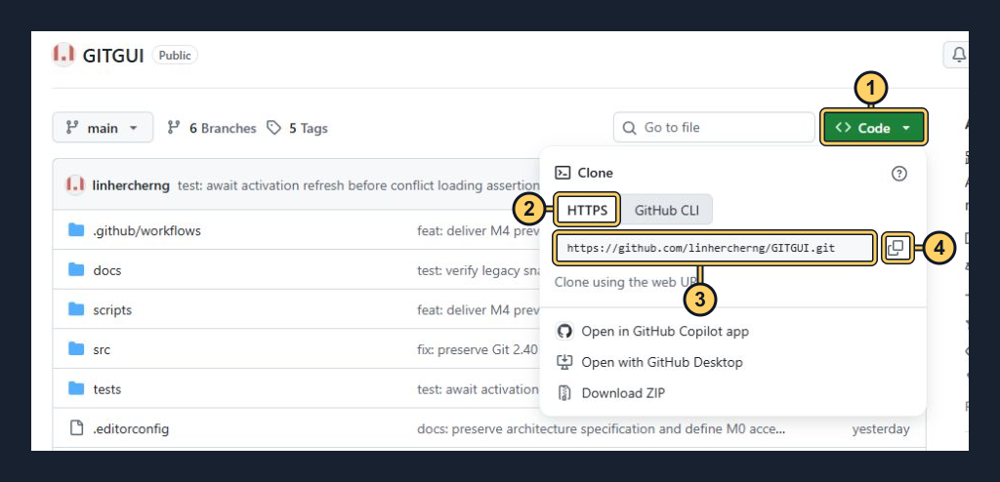](images/walkthrough/20-01-github-url.png)

| 圖中編號 | 要做的事 |
| --- | --- |
| 1 | 點擊綠色 **Code**。 |
| 2 | 選擇 **HTTPS**。 |
| 3 | 核對 URL 是自己的帳號／`hello-backup.git`，不要複製本參考圖中的 GITGUI URL。 |
| 4 | 點擊複製圖示，稍後貼到「遠端管理」。 |

**圖 20-B：GITGUI 起始操作入口。**

[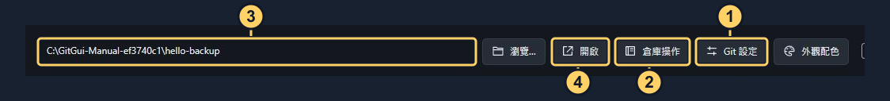](images/walkthrough/20-02-start.png)

| 圖中編號 | 要做的事 |
| --- | --- |
| 1 | 先點擊 **Git 設定**，確認可使用的 Git；免安裝版的路徑說明見第 1 章。 |
| 2 | 新的空資料夾：點擊 **倉庫操作**，接著看圖 20-C。 |
| 3 | 已有 Git 倉庫：輸入自己的 **倉庫路徑**。 |
| 4 | 已有 Git 倉庫：點擊 **開啟**；不必再次初始化。 |

### 20.2 建立本機 Git 倉庫

依資料夾目前的情況，選擇下面一種方法即可。

**A. 專案資料夾尚未建立，或目前是空資料夾**

1. 在 GITGUI 按「倉庫操作」。
2. 在「目的資料夾」填入 `C:\Projects\hello-backup`；初始化本機倉庫時，URL 欄位可留空。
3. 按「初始化倉庫」，等待完成；若尚未顯示該倉庫，將主畫面的「倉庫路徑」設為此路徑，再按「開啟」。
4. 用自己的編輯器或檔案總管，把專案檔案建立或複製到這個資料夾。不要把另一個倉庫的 `.git` 資料夾一起複製進來。

**圖 20-C：初始化新的空資料夾。**

[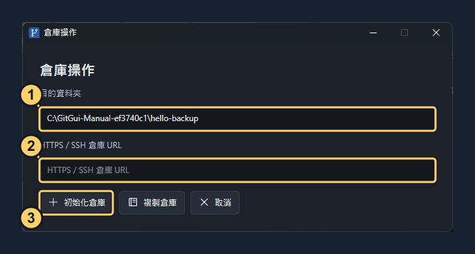](images/walkthrough/20-03-init.png)

| 圖中編號 | 要做的事 |
| --- | --- |
| 1 | 輸入新的／空的專案資料夾，例如 `C:\Projects\hello-backup`。 |
| 2 | **URL 留空**；這裡是本機初始化。 |
| 3 | 點擊 **初始化倉庫**，完成後才把專案檔案放入資料夾。已有檔案請改用下面的方法 B。 |

**B. 專案資料夾已經有檔案，但還不是 Git 倉庫**

本機修改版可以直接在 GUI 操作，不需要開啟 PowerShell：

1. 按主畫面的「倉庫操作」。
2. 在「目的資料夾」旁按「瀏覽…」，選擇原有的專案資料夾，例如 `C:\Projects\hello-backup`；也可直接填入路徑。
3. 第一次使用 Git 時，填寫「提交者姓名」與「提交者電子郵件」。兩欄只儲存在這個倉庫，不影響其他專案；若已有可用的 Git 身分設定，可兩欄都留空。
4. **URL 留空**，按「初始化倉庫」。程式只建立 `.git`，不改寫原檔案、`.gitignore`，也不會上傳或自動暫存。
5. 完成後主視窗會自動開啟這個倉庫，顯示原有檔案的變更。先依第 20.3 節檢查 `.gitignore`，再於第 20.4 節按「全部暫存」、輸入訊息並按「提交」。

初始化不會建立遠端。完成上述步驟就有第一筆本機 Git 紀錄，日後有需要再設定遠端與 Push。若資料夾本身或父資料夾已有 Git 倉庫，程式會拒絕重新初始化，請直接開啟原倉庫。Clone 仍須使用全新或空白目錄。

**C. 專案已經是 Git 倉庫**

直接在 GITGUI 開啟原有資料夾，沿用既有歷史，不需要重新初始化。若現有分支叫 `master` 或其他名稱，後面步驟中的 `main` 請換成實際分支名稱。

完成時應看到正確的倉庫路徑與目前分支；新初始化的倉庫是 `main`，尚未有提交是正常的。

### 20.3 準備檔案、忽略規則與作者資料

1. 例如在專案資料夾建立 `README.md`，內容如下；已有 README 的專案可保留自己的內容：

   ```markdown
   # hello-backup

   這是我的第一個備份專案。
   ```

2. 在同一層建立名為 `.gitignore` 的檔案，依專案調整。以下是常見開發專案的起點，不要把需要保存的檔案誤列為忽略：

   ```gitignore
   .env
   .env.*
   !.env.example
   node_modules/
   bin/
   obj/
   .vs/
   *.log
   ```

3. 確認檔名不是 `.gitignore.txt`，且帳密、Token、私鑰或真實環境設定沒有出現在準備上傳的清單中。`.gitignore` 本身需要提交；它不會自動取消已追蹤檔案的追蹤。
4. 本機修改版的新倉庫可在第 20.2 節的初始化視窗填寫姓名與電子郵件，之後直接使用 GUI 暫存與提交，無須開啟終端機。以下指令僅供舊倉庫尚未設定作者時使用；電子郵件可使用 GitHub 提供的 noreply 地址：

   ```text
   git config --local user.name "你的姓名"
   git config --local user.email "you@example.com"
   ```

5. 若有使用終端機，**關閉終端機視窗**後再繼續 GUI 操作。終端機開啟時會占用寫入佇列；若出現「信任此倉庫」，確認是自己的專案並閱讀設定後再同意。

作者姓名／電子郵件用於提交紀錄，與 GitHub 登入是兩件事。

**圖 20-D：作者設定與後續遠端管理的入口。**

[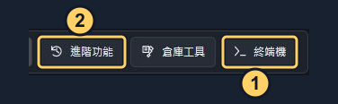](images/walkthrough/20-03-tools.png)

| 圖中編號 | 要做的事 |
| --- | --- |
| 1 | 需要設定作者時，點擊 **終端機**，輸入上方兩行 `git config --local` 指令；完成後關閉終端機。 |
| 2 | 暫時先不用點；第一次提交完成後，第 20.5 節會從 **進階功能** 設定遠端。 |

### 20.4 暫存並建立第一次提交

1. 按「重新整理」，在「工作區」的「未暫存」清單確認專案檔案與 `.gitignore` 都已列出。
2. 選取檔案，檢查右側差異；需要忽略的內容不應列入提交。
3. 檔案都確認過後按「全部暫存」；若只想備份其中幾個檔案，改為選取後按「暫存選取」。
4. 切換到「已暫存」，再檢查一次這次將保存的內容。
5. 在提交訊息輸入 `初始化專案：加入專案檔案與說明`，保持「修改上一筆提交」未勾選，按「提交」。
6. 等待成功，再到「提交歷史」確認出現這筆訊息。若仍有未暫存檔案，代表那些內容尚未包含在這次提交中。

**圖 20-E：先看差異，再全部暫存。**

[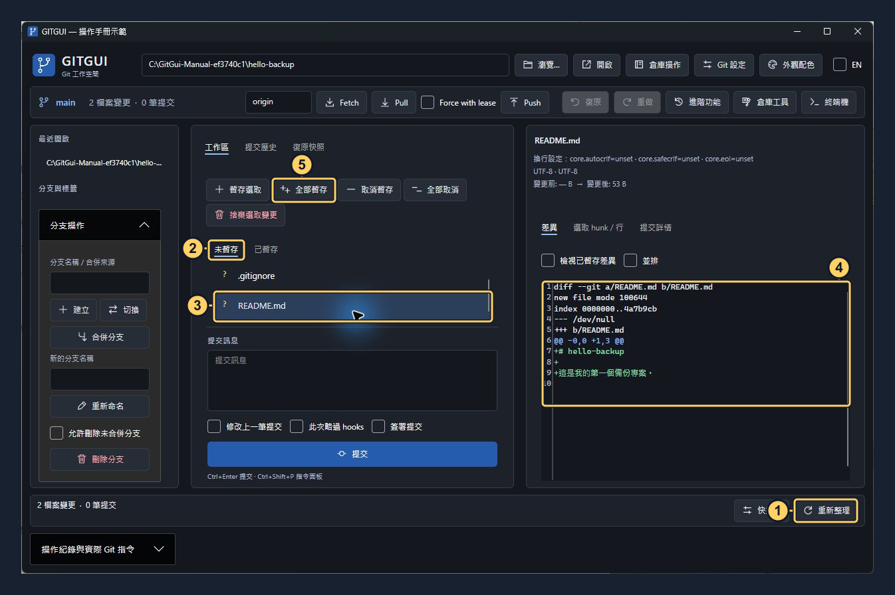](images/walkthrough/20-04-review.png)

| 圖中編號 | 要做的事 |
| --- | --- |
| 1 | 點擊 **重新整理**。 |
| 2 | 選擇 **未暫存**。 |
| 3 | 點選 `README.md`；其他檔案（含 `.gitignore`）也要逐一檢查。 |
| 4 | 核對右側差異，綠色 `+` 是新增內容。 |
| 5 | 全部檢查完才點擊 **全部暫存**。只保存部分檔案時使用旁邊的「暫存選取」。 |

**圖 20-F：核對暫存內容並提交。**

[](images/walkthrough/20-05-commit.png)

| 圖中編號 | 要做的事 |
| --- | --- |
| 1 | 點擊 **已暫存**，確認要保存的檔案都有列出。 |
| 2 | 核對已暫存差異；切換頁籤後右側會勾選「檢視已暫存差異」。 |
| 3 | 輸入 `初始化專案：加入專案檔案與說明`。 |
| 4 | 保持 **修改上一筆提交** 未勾選。 |
| 5 | 點擊 **提交**，等待操作完成。 |

**圖 20-G：確認第一次本機提交。**

[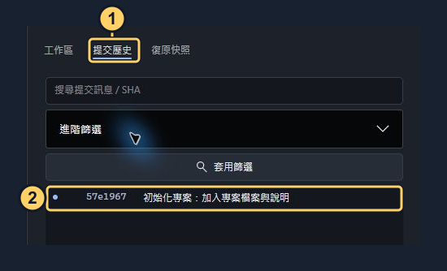](images/walkthrough/20-06-history.png)

圖中 **1** 點擊「提交歷史」；**2** 核對第一次提交訊息與 SHA。你的 SHA 會不同，這是正常的。

**到這裡只完成本機保存，GitHub 還沒有收到檔案。** 接下來還要設定遠端並 Push。

### 20.5 設定 GitHub 遠端

1. 按主畫面「進階功能」（圖 20-D 的 2），切換到「遠端管理」。
2. 「遠端名稱」填 `origin`，「HTTPS / SSH 倉庫 URL」填入第 20.1 節複製的 HTTPS URL。
3. 保持「設定 Push URL（取消則為 Fetch URL）」未勾選，按「新增遠端」。
4. 確認清單出現 `origin`，選取後核對顯示的 URL，然後關閉進階視窗。
5. 如果 `origin` 原本就存在，先核對其 URL；不要重複新增。確實需要改網址時，選取該遠端、填入正確 URL，再按「儲存 URL」，並核對是否另有獨立的 Push URL。

**圖 20-H：新增自己的 GitHub 遠端。**圖中 URL 是填寫範例，`YOUR-ACCOUNT` 必須換成自己的帳號；可直接貼上圖 20-A 複製的網址。

[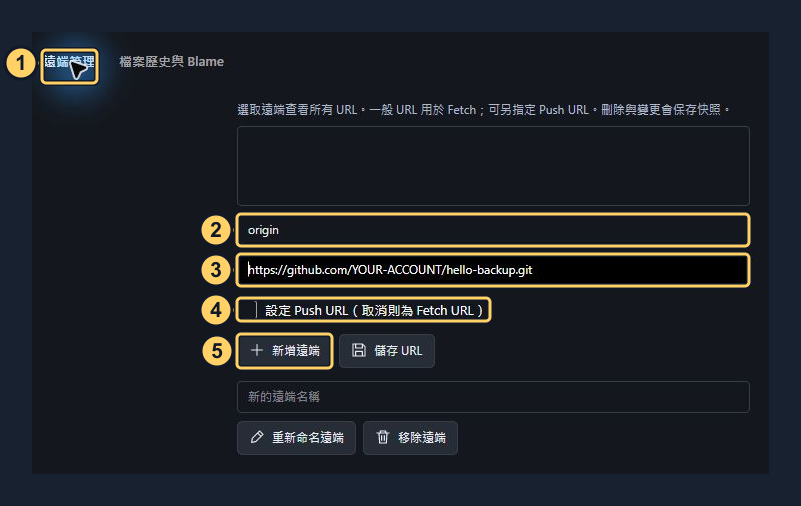](images/walkthrough/20-07-remote.png)

| 圖中編號 | 要做的事 |
| --- | --- |
| 1 | 點擊 **遠端管理**。 |
| 2 | 輸入 **origin**。 |
| 3 | 貼上自己的完整 **HTTPS URL**。 |
| 4 | 保持 **設定 Push URL** 未勾選。 |
| 5 | 點擊 **新增遠端**，等待成功。接著選取左側出現的 `origin` 核對 URL，再關閉視窗。 |

### 20.6 第一次 Push 並確認備份成功

1. 回主畫面，確認分支是 `main`，上方「遠端」欄位填 `origin`，保持 `Force with lease` 未勾選。
2. 按「Push」。若出現信任或分支名稱確認，閱讀內容並核對此次目標後再確認。
3. 若既有憑證工具開啟瀏覽器登入，依提示登入有該倉庫寫入權限的 GitHub 帳號。若要求 GitHub Username／Password，Username 填帳號，Password 使用具該倉庫寫入權限的 Personal Access Token，不是 GitHub 登入密碼。不要把 Token 放進 URL 或專案檔案。
4. 等待成功；需要確認細節時，可展開「操作紀錄與實際 Git 指令」。第一次成功推送後會建立目前分支的 upstream，供後續同步使用。
5. 回 GitHub 重新整理倉庫頁面，切到 `main`，確認看到 `README.md`、`.gitignore`、其他預期檔案及剛才的提交訊息。可以再比對 GitHub 的提交 SHA 與 GITGUI 顯示的同一筆提交。

**圖 20-I：第一次一般 Push。**請先完成圖 20-H 的遠端設定。

[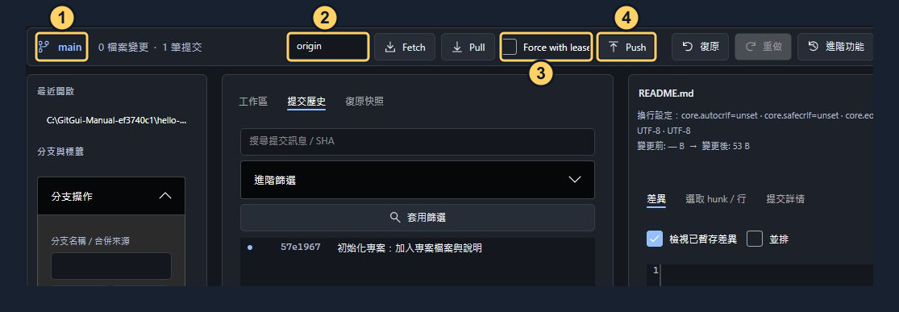](images/walkthrough/20-08-push.png)

圖中 **1** 核對 `main`；**2** 核對 `origin`；**3** 保持 `Force with lease` 未勾選；**4** 點擊「Push」。若有登入或目標確認，請本人核對後完成。此圖示範按鈕位置，不代表 `hello-backup` 已上傳到 GitHub。

**圖 20-J：到自己的 GitHub 倉庫驗證（現有 GITGUI 倉庫位置參考）。**

[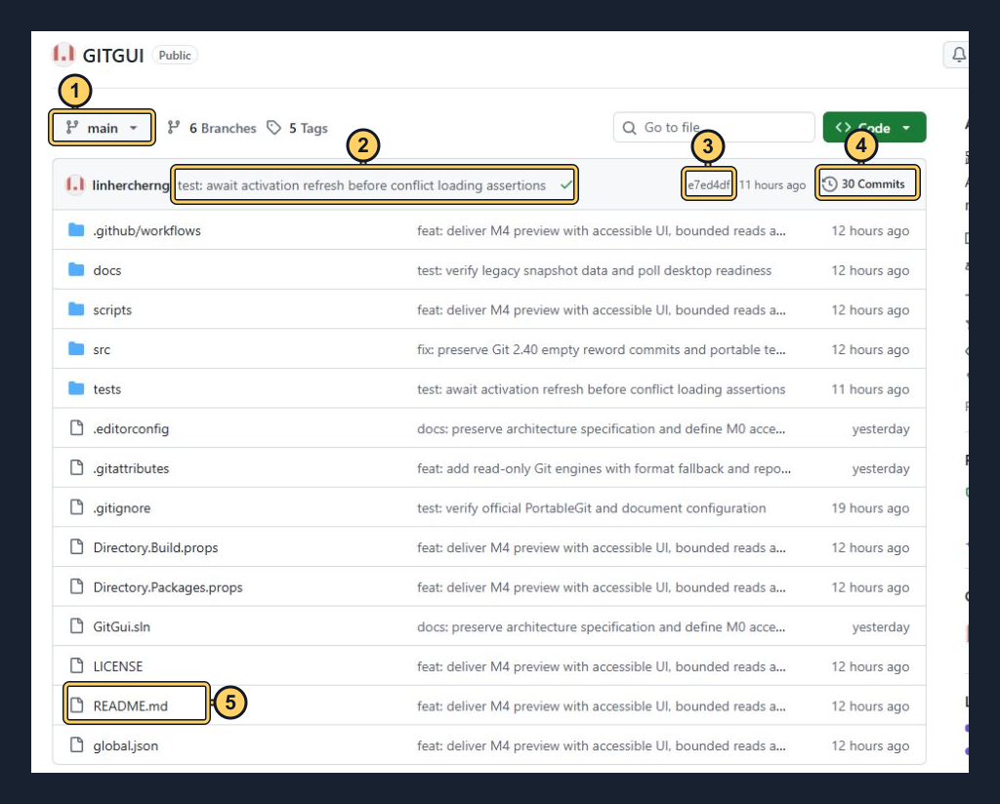](images/walkthrough/20-09-github-check.png)

| 圖中編號 | 要做的事 |
| --- | --- |
| 1 | 重新整理網頁後，核對分支是自己剛 Push 的 `main`。 |
| 2 | 核對最新提交訊息，應是自己的「初始化專案：加入專案檔案與說明」。 |
| 3 | 點擊短 SHA 可開啟提交詳情；它應與 GITGUI 的同一筆提交一致。 |
| 4 | 若要找更早的提交，點擊 **Commits**。數字會依自己的倉庫而不同。 |
| 5 | 點擊 `README.md` 核對內容；也要確認 `.gitignore` 與其他預期檔案存在。 |

確認檔案與提交都已在 GitHub 出現，才算完成這次遠端備份。未追蹤、被忽略或尚未提交的內容不會因為按 Push 而自動上傳。大型素材若需要 Git LFS，請先依第 11 章設定，再檢查對應的 LFS 上傳結果。

## 21. 完整範例：專案修改後再次更新上傳

沿用第 20 章已備份成功的 `C:\Projects\hello-backup`、`main` 與 `origin`。之後每次更新都使用同一個倉庫，不必重新建立 GitHub 倉庫或初始化。

### 21.1 修改並保存專案

1. 在 GITGUI 從「最近開啟」選擇專案，或輸入原路徑再按「開啟」；確認目前分支與遠端正確。
2. 如果還沒開始修改，先按「Fetch」檢查遠端是否有新提交；本機乾淨且遠端有更新時，先 Pull 並確認成功，再開始編輯。
3. 用原本的編輯器修改專案。例如在 `README.md` 最後增加一行 `第二版：加入聯絡資訊。`，並儲存檔案。若你已經修改完成，直接進入下一節，不必重做這個示範修改。

**圖 21-A：開啟原專案，認明同步按鈕。**本圖已存入示範修改，因此顯示 1 個變更；尚未修改時應是乾淨狀態。

[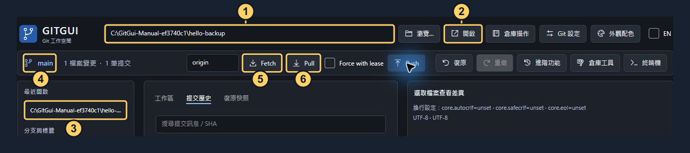](images/walkthrough/21-01-open.png)

| 圖中編號 | 要做的事 |
| --- | --- |
| 1、2 | 輸入原專案路徑，點擊 **開啟**。 |
| 3 | 或從 **最近開啟** 選擇原專案，兩種方式擇一。 |
| 4 | 核對目前分支。 |
| 5 | 開工前點擊 **Fetch** 檢查遠端狀態。 |
| 6 | 本機乾淨、遠端有新提交時才 **Pull**；已修改的檔案先妥善保存，依第 21.3 節處理。 |

### 21.2 檢查、暫存與提交本次修改

1. 回到 GITGUI 按「重新整理」，確認「未暫存」出現 `README.md`；新增或刪除檔案也會列為變更。
2. 選取它，在右側檢查差異，確認新增的文字正確，沒有混入本次不想保存的修改。
3. 按「暫存選取」；多個檔案可逐一暫存，全部檢查過才使用「全部暫存」。
4. 切到「已暫存」核對；如果暫存後又編輯檔案，後續修改仍要再暫存，才會包含在這筆提交中。
5. 提交訊息輸入 `更新專案說明：加入聯絡資訊`，保持「修改上一筆提交」未勾選，按「提交」。
6. 到「提交歷史」確認多出這筆提交。提交成功但尚未 Push 時，GitHub 仍會顯示舊版本。

**圖 21-B：找到這次修改，再暫存選取。**

[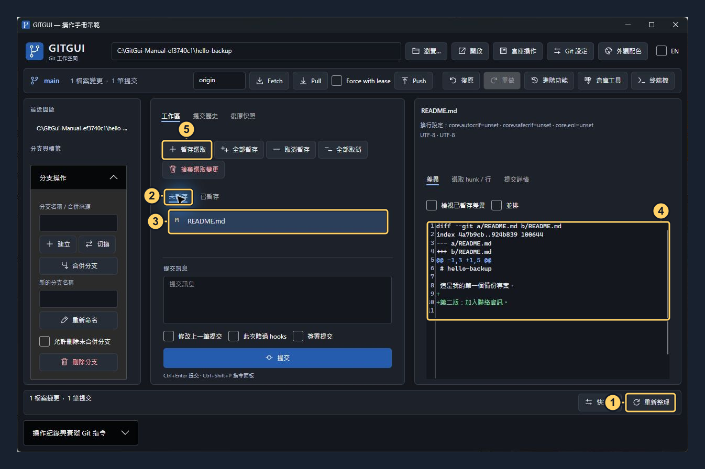](images/walkthrough/21-02-review.png)

| 圖中編號 | 要做的事 |
| --- | --- |
| 1、2 | 點擊 **重新整理**，切換 **未暫存**。 |
| 3 | 選取 `README.md`。 |
| 4 | 核對綠色新增行是 `第二版：加入聯絡資訊。`。 |
| 5 | 點擊 **暫存選取**；不要誤按「捨棄選取變更」。 |

**圖 21-C：建立新的提交。**

[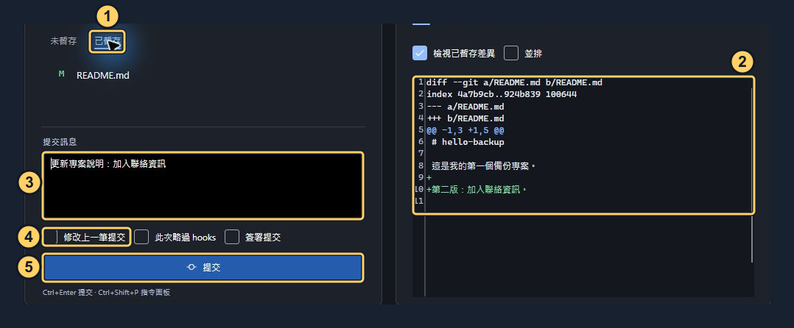](images/walkthrough/21-03-commit.png)

| 圖中編號 | 要做的事 |
| --- | --- |
| 1、2 | 切換 **已暫存**，核對本次修改確實包含在差異中。 |
| 3 | 輸入 `更新專案說明：加入聯絡資訊`。 |
| 4 | 保持 **修改上一筆提交** 未勾選。 |
| 5 | 點擊 **提交**，等待完成，再到提交歷史核對。 |

### 21.3 檢查遠端更新，再 Push

1. 確認沒有遺漏的本機修改；若需要全部備份，先把剩下的預期修改也提交。
2. 遠端欄位使用 `origin`，按「Fetch」，檢查 `origin/main` 是否有別台電腦、其他人或 GitHub 網頁編輯所新增的提交。
3. 只有本機新增提交、遠端沒有新提交時，可直接按「Push」，保持 `Force with lease` 未勾選。
4. 如果遠端也有新增提交，先在本機修改已提交或妥善保存的狀態下按「Pull」。合併成功後再 Push；若出現衝突，依第 5 章解決並完成合併提交，再上傳。不要用強制推送覆蓋尚未整合的遠端內容。
5. 如果 Push 時剛好又有別人更新而被拒絕，重新 Fetch、檢查並整合遠端更新後再試。
6. 等待成功後，開啟 GitHub 的 `hello-backup` 倉庫，切到 `main`，確認最新提交訊息是 `更新專案說明：加入聯絡資訊`，且 README 已顯示新增文字。若剛才產生合併提交，最新一筆可能是合併訊息，請在歷史中確認本次修改也已包含。

**圖 21-D：提交後先檢查遠端，再決定是否 Pull，最後 Push。**

[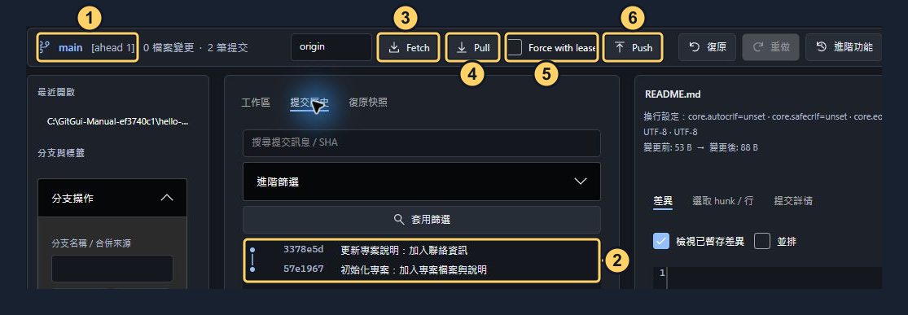](images/walkthrough/21-04-sync.png)

| 圖中編號 | 要做的事 |
| --- | --- |
| 1 | 核對目前分支；`ahead 1` 表示本機比已取得的上游多 1 筆提交，仍須 Fetch 確認最新遠端狀態。 |
| 2 | 核對最新一筆是本次修改，舊的第一次提交仍在。 |
| 3 | 點擊 **Fetch**，等待完成並檢查遠端。 |
| 4 | 遠端也有新提交才 **Pull**，依文字步驟完成整合／衝突處理。不要把 Fetch → Pull → Push 當成不需判斷的連續點擊。 |
| 5 | 保持 **Force with lease** 未勾選。 |
| 6 | 確認可正常推進遠端後，點擊 **Push**。 |

**圖 21-E：取得本機提交 SHA，與 GitHub 比對。**

[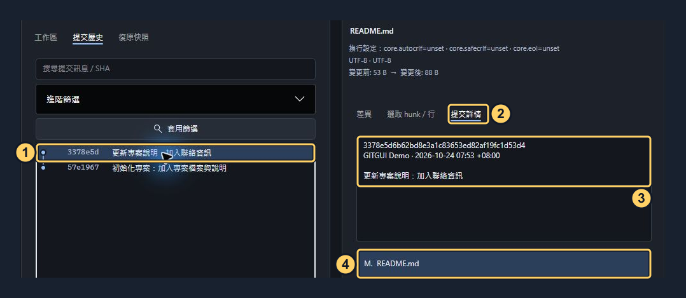](images/walkthrough/21-05-verify.png)

圖中 **1** 點選新提交；**2** 右側顯示「提交詳情」；**3** 核對完整 SHA、作者與訊息；**4** 確認這筆包含 `README.md`。本圖是本機示範提交，SHA 不會與下面的 GITGUI 參考圖相同；實際操作時應比對自己倉庫的同一筆提交。

**圖 21-F：核對 GitHub 上的同一筆提交（現有 GITGUI 倉庫位置參考）。**先依圖 20-J 的 3 點擊自己倉庫的最新 SHA。

[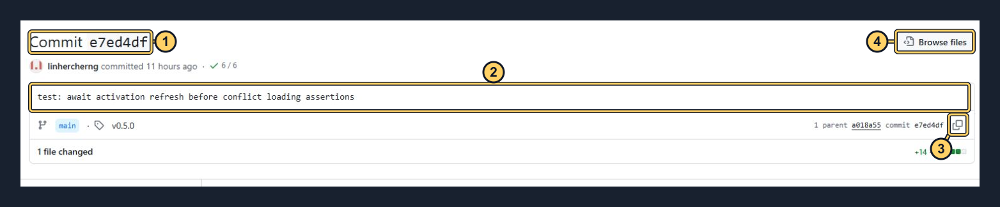](images/walkthrough/21-06-github-sha.png)

| 圖中編號 | 要做的事 |
| --- | --- |
| 1 | 核對自己的短 SHA，應與 GITGUI 所選提交的開頭一致。 |
| 2 | 核對提交訊息是本次更新。 |
| 3 | 點擊複製圖示可取得完整 SHA，與圖 21-E 的 3 比對。 |
| 4 | 點擊 **Browse files**，再開啟 `README.md`，確認這筆提交已包含新增文字。也可回倉庫首頁核對 `main` 的 README。 |

日常順序可記為：**儲存檔案 → 檢查差異 → 暫存 → 提交 → Fetch／必要時 Pull → Push → GitHub 核對。**

### 21.4 更新上傳時的常見狀況

| 現象 | 應該怎麼做 |
| --- | --- |
| 檔案改了，Push 卻顯示已是最新 | 確認編輯器已儲存，以及變更是否已暫存並提交。Push 只傳提交，不直接傳工作目錄檔案。 |
| 新檔案沒有出現在清單 | 檢查是否存進正確專案資料夾，以及是否被 `.gitignore` 忽略。 |
| 顯示 `origin` 已存在 | 到「進階」→「遠端管理」核對／修改既有設定，不必再次新增。 |
| 第一次上傳時發現 GitHub 已有 README，並出現兩邊歷史無關的錯誤 | 保留原專案，將 GitHub 倉庫複製到另一個新路徑，再把要保存的專案檔案複製進去（不要覆蓋 `.git`），檢查後暫存、提交並 Push。 |
| Push 顯示 `non-fast-forward` 或需要先 Fetch | 本機先保存修改，Fetch 並檢查遠端歷史；必要時 Pull、處理衝突後再 Push。 |
| GitHub 提示沒有權限或驗證失敗 | 核對 URL、登入帳號與該倉庫的寫入權限；HTTPS 使用憑證工具或 Token，不使用 GitHub 登入密碼。 |
| 已成功上傳，但 GitHub 看起來沒變 | 核對倉庫擁有者、遠端 URL、網頁目前選取的分支，以及最新提交 SHA。 |
| 想取回另一台電腦 | 在新的空白目的路徑用「倉庫操作」→「複製倉庫」，填入同一 HTTPS URL；之後開工先 Fetch／Pull。 |

GitHub 的空白倉庫與 HTTPS 驗證說明可參閱官方文件：[將本機程式碼加入 GitHub](https://docs.github.com/en/migrations/importing-source-code/using-the-command-line-to-import-source-code/adding-locally-hosted-code-to-github?platform=windows)、[遠端倉庫與 HTTPS 驗證](https://docs.github.com/en/get-started/git-basics/about-remote-repositories)。本範例的 GITGUI 按鈕與行為依本專案介面撰寫。

相關文件：[M4 驗收](M4-ACCEPTANCE.md)、[M4 效能](M4-PERFORMANCE.md)、[M3 相容性](M3-COMPATIBILITY.md)、[ARM 決策](M3-ARM-DECISION.md)、[原始規格](specification.md)、[Windows 打包](WINDOWS-RELEASE.md)。Release：<https://github.com/linhercherng/GITGUI/releases>。
