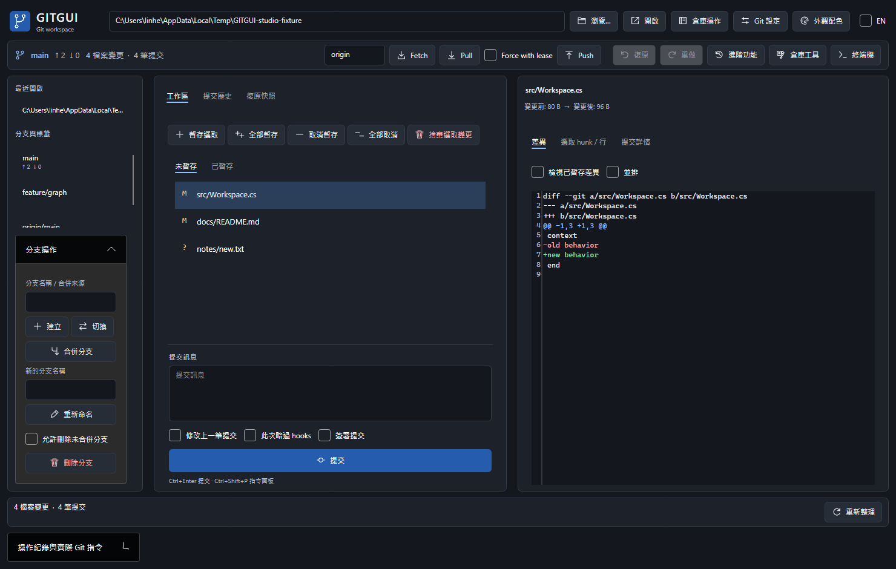

# GITGUI 操作手冊

適用版本：0.4.0（M3）。Windows x64 免安裝包內含 Portable Git、Git LFS、SSH 工具及 .NET 執行環境。

## 1. 解壓縮與啟動

1. 下載 `GITGUI-0.4.0-win-x64-portable.zip`。
2. 在檔案總管選擇「全部解壓縮」，保留整個資料夾結構。
3. 開啟解壓縮資料夾，執行 `GitGui.App.exe`。請勿直接從 ZIP 內執行。
4. 第一次使用可先到「Git 設定」確認執行檔來源為同資料夾下的 `PortableGit\cmd\git.exe`。

不必另外安裝 Git 或 .NET。移動程式時，請搬移整個資料夾。簽章、HTTPS 登入、SSH 遠端連線仍使用你自己的身分設定與金鑰。

若 Windows 顯示下載程式的信任提示，先確認下載自本專案 Release，並核對 `SHA256SUMS.txt`；此版本未提供程式碼簽章。

```powershell
Get-FileHash -LiteralPath 'C:\下載\GITGUI-0.4.0-win-x64-portable.zip' -Algorithm SHA256
```

上方 `C:\下載` 是範例，請換成你的實際下載位置。

## 2. 畫面與外觀

主畫面左側選擇最近倉庫與 refs，中間切換工作區、提交圖與快照並輸入提交訊息，右側檢視差異、衝突與提交詳情。操作面板可查看實際 Git 指令與輸出。

「外觀」可選擇 Graphite、Midnight、Forest、Porcelain 四種配色。主工具列的 EN 選項可切換繁體中文或英文。外觀設定會保留供下次啟動使用。



## 3. 開啟、建立或複製倉庫

- 已有本機倉庫：按「瀏覽」選擇工作目錄，或直接輸入路徑後按「開啟」。
- 建立新倉庫：在「倉庫操作」選擇「初始化」，填寫全新或空白資料夾；預設初始分支為 `main`。
- 從遠端複製：在「倉庫操作」選擇「Clone」，輸入 HTTPS、SSH 或本機倉庫來源，以及全新或空白的目的資料夾。

首次寫入陌生倉庫前，程式會詢問是否信任，並列出可能執行外部程式的 hooks、filters、SSH 或憑證設定。確認來源後再同意。程式不會自動修改 `safe.directory`。

Git 作者資料由 Git 設定提供；若尚未設定，可在內建終端機輸入：

```text
git config --local user.name "你的名字"
git config --local user.email "you@example.com"
```

## 4. 修改、暫存與提交

1. 在編輯器修改工作目錄內的檔案。
2. 回到 GITGUI，按重新整理，或讓視窗重新取得焦點。
3. 選擇變更檔案，檢視差異；按「暫存」將選取檔案加入 index。
4. 文字差異可選擇 hunk 或行來暫存／取消暫存；二進位檔以整檔處理。
5. 輸入提交訊息，按「提交」。只有已暫存的內容進入提交。

「修改上一筆」會重寫最新提交。使用前先確認這筆提交是否已分享給其他人。「略過 hooks」只對本次操作生效；預設不勾選。

「捨棄變更」會替換選取的工作檔案，執行前有確認與快照。請先看清楚檔案清單。

## 5. 分支、同步與衝突

- 建立分支：輸入分支名稱後建立，再切換到該分支。
- 切換分支：選取本機分支、遠端追蹤分支或提交；切換提交會進入 detached HEAD。
- Fetch：取得遠端最新 refs，不合併工作目錄。
- Pull：取得遠端內容後合併，遵守 `pull.ff`；若倉庫設定 rebase，程式會先確認本次改用 merge。
- Push：將目前分支推送到選定遠端。強制推送使用 `--force-with-lease --force-if-includes`；受保護分支需要輸入分支名稱確認。

遇到衝突，選擇衝突檔案，使用三方編輯、整檔 ours／theirs 或外部 mergetool。檢查結果後「標記已解決」，再完成提交或到「進階」繼續操作。二進位與符號連結衝突使用整檔選擇。

## 6. 快照復原與重做

會修改歷史或替換內容的操作，依功能自動建立快照。主畫面快照清單、操作後的「復原」，或工具視窗的「還原最近快照」可還原本地狀態。

1. 先讀取快照的時間與操作名稱。
2. 按還原並確認。程式會先保存目前狀態作為重做快照。
3. 還原後重新整理，確認 HEAD、分支、暫存區與工作檔案。
4. 如需重做，選擇剛才還原前自動建立的快照再還原。

快照保存在倉庫的 Git 物件與內部 refs，清單索引保存在應用程式 SQLite。它是操作復原工具，請另做獨立備份；刪除整個倉庫也會失去這些快照。遠端已推送內容不會因本地還原而撤回。

子模組快照僅處理父倉庫，詳細邊界見第 9 節；工作樹、LFS 與 bisect 依各自方式處理。快照還原若遇到 index/ref 鎖或可能覆蓋未保存資料，會拒絕執行，請先處理原始原因。

更新／停用子模組或移除工作樹時，若 index 有 assume-unchanged 或 skip-worktree flags，程式會保守拒絕，因為 Git status 可能隱藏未保存的內容。先另行備份並清除相關 flags，再重試。
對使用 sparse-checkout 的工作樹，可先在該工作樹停用稀疏檢出，再確認內容並移除。

## 7. 進階歷史操作

按「進階」開啟分頁：

- **Stash**：可包含未追蹤檔案，支援 push、apply、pop、drop。pop 成功後移除該項；發生衝突時請先處理衝突。
- **互動 Rebase**：指定上游，讀取計畫後拖曳／上下移動排序，選擇 pick、reword、edit、squash、fixup、drop；檢查訊息後執行。目前限線性提交，不接受 merge commit 計畫。
- **歷史操作**：選擇提交進行 cherry-pick、revert 或 reset。soft 保留暫存區與工作檔；mixed 重設暫存區；hard 會替換工作檔並要求確認。
- **標籤**：建立輕量、附註或簽章標籤，或刪除本地標籤。這不會自動推送或刪除遠端標籤。
- **檔案歷史／Blame**：選擇檔案查看逐行提交資訊與重新命名前的歷史。刪除的檔案仍可查看歷史。
- **Reflog／遠端**：檢視本地 HEAD 移動紀錄；新增、改名、修改 URL 或移除遠端。移除遠端不會刪除遠端伺服器上的倉庫。

Rebase、cherry-pick 或 revert 中斷時，可使用「繼續」「略過」「中止」。edit 暫停時先修改檔案、暫存並 amend，再繼續。

## 8. 內建終端機

「終端機」會使用目前倉庫與同一套選定 Git。它是持續運行的逐行 shell，可輸入 Git 指令與一般命令，也會保留目前 shell 的工作目錄／環境變化。

終端機開啟時會占用該倉庫的寫入佇列；先關閉終端機，再使用圖形介面寫入。關閉會終止 shell 及其子行程。此版本尚未提供完整 VT／PTY、全螢幕互動工具或 Ctrl+C 控制；需要這些功能時請用外部終端機。

終端機內自行輸入的指令不會自動建立 GUI 快照。輸入會刪除或改寫資料的指令前，請自行確認與備份。

## 9. 子模組（Submodules）

按「倉庫工具」→「子模組」。

1. 新增：填入父倉庫內的相對路徑及來源 URL／本機絕對路徑，按「新增子模組」。
2. 已有項目：從清單選擇，按「初始化」登記設定，再按「更新」取出父倉庫 index 所指定的提交。
3. `.gitmodules` URL 變更後，可用「同步網址」同步設定。
4. 「包含巢狀子模組」控制更新／同步的 recursive 行為；不使用 force 或 remote-tracking 更新。
5. 「停用」對應 deinit，會移除子模組工作目錄並清除父倉庫中的初始化設定；髒檔案、未追蹤或被忽略資料會阻擋移除。

**父倉庫快照保存 gitlink、父倉庫 index／檔案與 submodule 設定，不保存子倉庫自己的 HEAD、refs、index、工作檔或物件資料庫。** 更新子模組前，請先在子倉庫內提交或 stash；若要復原子倉庫，請另外開啟該子倉庫操作。

復原「新增子模組」會還原父倉庫，但保留已 clone 的子倉庫資料夾。復原 deinit 不會自動重建子倉庫 checkout，可再初始化／更新。父倉庫一般操作不會自動遞迴切換子模組。檔案與 gitlink 的危險型態替換會被拒絕。

若既有子倉庫內還有巢狀 gitlink，而欲更新的提交尚未下載，程式會要求先在該子倉庫 Fetch，才能檢查目標是否覆蓋巢狀資料。請另行開啟子倉庫取得目標提交後再重試；不會直接以「下載並 checkout」繞過檢查。


## 10. 工作樹（Worktrees）

在「倉庫工具」→「工作樹」，可讓同一倉庫的不同分支同時存在於不同資料夾。

1. 新增：填寫全新或空白的絕對路徑、來源提交，以及新分支名稱。分支名稱留空會建立 detached 工作樹。
2. 選取項目，輸入原因後可鎖定，適合放在外接磁碟上的工作樹；需要移除前先解鎖。
3. 移除會要求確認，保留分支，且拒絕未提交／未追蹤／被忽略資料，不提供 force。
4. 「清理過期紀錄」對應 prune，只清理 Git 判定已失效且未鎖定的紀錄。

工作樹操作沒有快照 Undo。不能從目前正在開啟的工作樹移除自己；先改開另一個工作樹。共用同一個 Git common directory 的 GUI 操作會序列化。

Windows 使用 reftable 格式時，Git 在部分 Windows 版本可能已移除工作樹資料夾，卻因檔案仍被 Git 映射而無法刪除管理紀錄。程式會明確顯示此狀態，不會自動清理。請先確認外接磁碟與其他工作樹仍可存取，再按「清理過期紀錄」並確認；這會清理所有已失效且未鎖定的紀錄，不只剛移除的項目。原分支會保留。

## 11. Git LFS

在「倉庫工具」→「Git LFS」查看版本與狀態。

1. 先按「安裝至此倉庫」，設定本地 filter 與 pre-push hook。
2. 每行輸入一個追蹤規則，例如 `*.psd` 或 `assets/*.bin`，按「追蹤」。
3. 檢查並提交 `.gitattributes` 與實際大型檔案。
4. 設定遠端後，可執行 LFS Fetch 下載物件，或 LFS Pull 下載並取出目前提交的物件。
5. 「取消追蹤」只修改屬性規則，不改寫既有提交中的 LFS pointer 或歷史。

LFS 不是備份，也不自動進行歷史遷移。此工具沒有 LFS 快照 Undo；一般提交／快照仍依原有本地資料處理。遠端必須支援 LFS，登入、額度及網路錯誤會顯示在操作輸出。自訂 `core.hooksPath` 的倉庫，LFS 會依 Git 設定使用該 hooks 位置；既有不相容 hook 可能使安裝失敗。

## 12. 二分定位（Bisect）

在「倉庫工具」→「二分定位」：

1. 先提交或 stash 目前變更。
2. 輸入已知有問題的 bad 提交，以及較早且正常的 good 提交。good 必須是 bad 的祖先。
3. 按「開始」，Git 會取出待測提交。
4. 自行建置／執行程式判斷後，按「正常」「有問題」或「略過」。重複直到找到第一個有問題的提交。
5. 按「重設」執行 `git bisect reset`，回到原先分支／提交。關閉再開程式也能接續目前的 bisect。

此功能不自動執行測試命令，復原方式為 bisect reset。可能被 checkout 覆蓋的未追蹤／被忽略檔案會先被擋下；請先移走或妥善保存，再開始。

## 13. 稀疏檢出（Sparse-checkout）

在「倉庫工具」→「稀疏檢出」：

1. 先保存目前變更。
2. 勾選 cone 模式時，每行填入一個相對目錄，例如 `src`、`docs`；Git 也會保留必要的根層／父層檔案。
3. 不勾選 cone 時，每行使用 Git sparse-checkout 的 pattern 語法。
4. 按「套用」後，未包含的已追蹤檔案會從工作目錄隱藏，仍保存在 Git 歷史內。
5. 按「停用」取回完整工作目錄，或還原操作前快照。

快照還原保存選定工作樹的 sparse 設定、pattern、index skip flags 與實際存在的檔案。Git 啟用的 `extensions.worktreeConfig` 儲存格式升級會保留，以免破壞其他工作樹。資料夾／忽略檔案衝突會先拒絕處理。

## 14. 簽章提交與標籤

先依自己的環境設定 GPG 或 SSH 簽章；程式不產生、不儲存你的私鑰。提交時勾選「簽章」，建立標籤時勾選簽章選項並填寫訊息，即交給 Git 執行 `commit -S` 或 `tag -s`。

SSH 設定範例（請換成已有的私鑰實際路徑）：

```text
git config --local gpg.format ssh
git config --local user.signingkey "C:/Users/你的帳號/.ssh/id_ed25519"
```

簽章需要可用的 signer／agent；硬體金鑰、密碼提示與第三方 GPG 設定依你的環境而定。簽章成功不等同遠端平台已將該金鑰認定為你的帳號，請另外完成平台金鑰登記。

## 15. 常見問題與驗證範圍

| 現象 | 處理方式 |
| --- | --- |
| 找不到 Git | 在 Git 設定選擇 Portable Git 資料夾或 `git.exe`；最低 Git 2.40。 |
| `index.lock`／ref lock 存在 | 確認其他 Git 行程是否仍在運作；不要直接刪除活躍行程的鎖。 |
| 按鈕停用 | 等待操作完成、解決目前衝突，或先關閉占用佇列的內建終端機。 |
| Push 遭拒絕 | 先 Fetch 檢查差異；lease 過期時不要繞過保護直接強推。 |
| Hook／簽章失敗 | 展開指令輸出，依 Git 回報修正工具或倉庫設定。 |
| LFS 指令不可用 | 確認選的是完整 Portable Git；使用自己的 Git 時需另備 Git LFS。 |
| 還原被資料夾／子倉庫擋下 | 先另行備份該資料，保留原倉庫並檢查實際路徑；不要為了還原而直接刪除子倉庫。 |

Windows 發布包為 x64。ARM 原生套件尚未正式發布；跨平台 CI 與實際 Windows ZIP／桌面測試的結果以同版 Release 的 `verification.json` 及相容性文件為準。大型效能目標、完整無障礙與 VT／PTY 屬於後續工作，尚未宣稱完成。

相關文件：[M3 相容性](M3-COMPATIBILITY.md)、[ARM 決策](M3-ARM-DECISION.md)、[原始規格](specification.md)、[Windows 打包](WINDOWS-RELEASE.md)。Release：<https://github.com/linhercherng/GITGUI/releases>。
